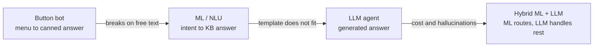
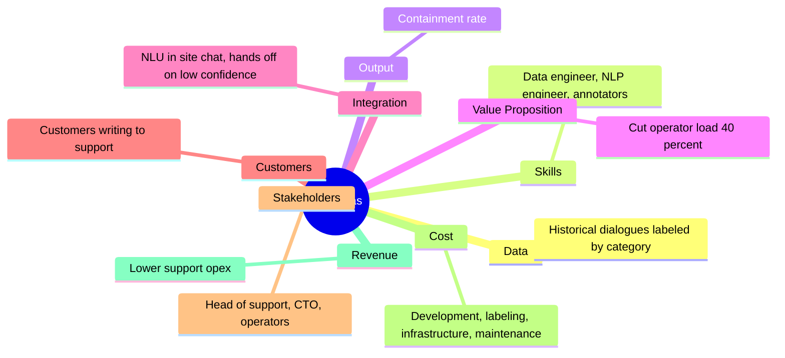
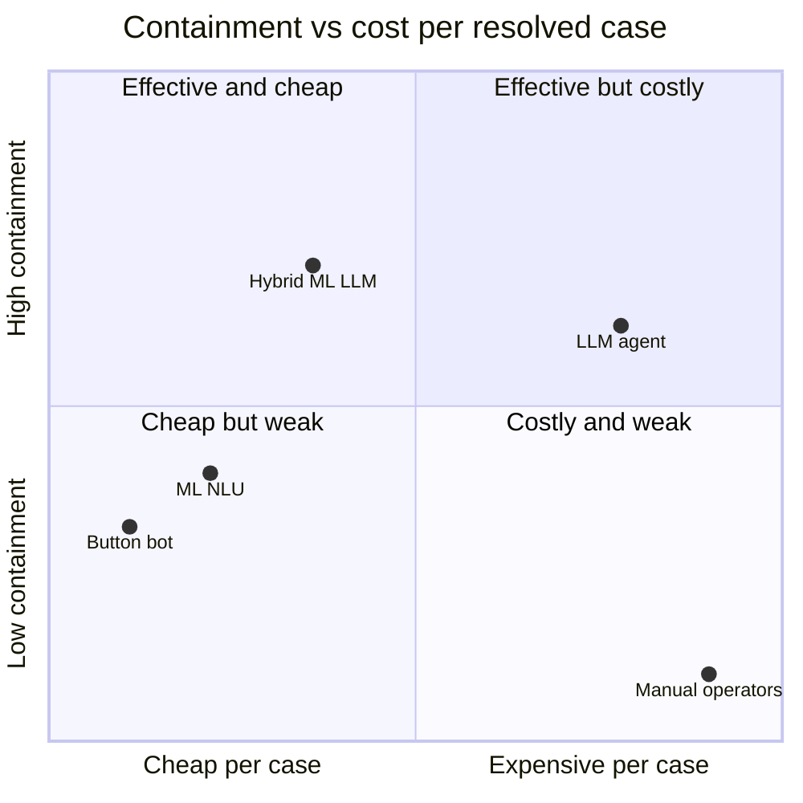

# Introduction to ML/AI Products

> Module: Immersion in the Profession · Topic: Immersion in the Profession · Lesson 3
> Original: «Знакомство с ML/AI-продуктами»

## At a glance

*Figure: Three automation approaches in the support case, and the limitation that pushes to the next one.*

## Key ideas
- In classic software, code defines behavior. In ML/AI products, a **model trained on data** defines behavior — which changes the dev cycle, metrics, risks and the PM's responsibilities.
- The lesson walks one case — automating customer support — through three approaches (button bot → ML/NLU → LLM agent) and shows how the PM's job changes at each step.
- The right question is not "ML or LLM?" but "which cases should go to the LLM?"

## Concepts & definitions
- **Containment rate** — share of conversations the bot resolves without handing off to a human operator.
- **CSAT** — customer satisfaction score.
- **NLU (Natural Language Understanding)** — recognizing intent/meaning in free text.
- **Intent** — the type of user goal ("check subscription status", "request refund"). NLU matches a message to an intent with a confidence score.
- **Confidence threshold** — above it, the bot answers from a template; below it, the chat goes to an operator.
- **Precision** (per class) — of all messages the model labeled as class X, the share that really were X. Precision 0.71 on "refund" ⇒ 29% of "refund" predictions were wrong.
- **Data labeling** — tagging raw data (e.g., dialogues by category) for analysis or training.
- **Long tail** — many rare, unique requests that individually are infrequent but add up to a meaningful share.
- **Prompt engineering** — natural-language instructions that set an LLM's behavior; for a PM, the prompt is effectively a **product spec**.
- **RAG (Retrieval-Augmented Generation)** — the model fetches relevant documents from a knowledge base before answering, so it relies on current company data rather than its general training.

## Frameworks / methods
**Start with the data, not the solution.** Before picking a tech approach, study the requests. Ways to analyze 100k chat logs (all valid, often combined): manually read a few hundred; have an analyst cluster them; define categories and label a sample; ask an LLM to propose topics (then verify).

**Three automation approaches and the PM's job in each:**

| Approach | How it works | Main limitation | PM's work |
|---|---|---|---|
| Button bot | Menu → canned answer | Breaks when users type free text | Design every dialog branch; define off-script behavior; decide what the bot refuses |
| ML / NLU | Classify intent → answer from KB | Knows only what it was trained on; new request types break it | Define intent taxonomy and boundaries; set confidence threshold; monitor quality per intent |
| LLM agent | Generates context-specific answer | Generation quality is hard to control; cost | Write prompt as spec; design guardrails; calculate token cost per dialog |
| Hybrid ML + LLM | ML classifies/routes; LLM handles cases without a ready answer | Complex | (covered in full course) |

Choice depends on what you have most of: time, budget, or team readiness/skills.

**AI Canvas** (adapted Business Model Canvas, filled during discovery) — 9 blocks:
- **Data** — what data is needed (e.g., historical dialogues labeled by category)
- **Skills** — which specialists (data engineer, NLP engineer, annotators)
- **Output** — key metric optimized (containment rate)
- **Value Proposition** — value created (cut operator load 40% without quality loss)
- **Integration** — how it plugs into existing systems (NLU in site chat, uses KB, hands off on low confidence)
- **Customers** — end users (customers writing to support)
- **Stakeholders** — who cares about results (head of support, CTO, operators)
- **Cost** — development, labeling, infrastructure, model maintenance
- **Revenue** — economic effect (lower support opex)

*Figure: The AI Canvas blocks filled in for the support-automation case.*

Data questions a PM must answer: how many examples per category, how to handle class imbalance (one category 10× more frequent), what to do with requests that fit no category.

## Case / example
- Setup: 250k active users, +20% QoQ; 10 operators; support = 18% of opex; ~1,000 requests/day; response time 8 min (day) to 4 h (night). SMART goal: **cut operator load 40% in 6 months without quality loss**.
- Request mix: subscription/promo codes 31%, payments 24%, refunds/cancellations 15% (top-3 = 70%); account access 9%, tech errors 6%; other/long tail 15%. Mostly predictable, repetitive intents → good for automation.

| Stage | Containment | CSAT | Cost per resolved case |
|---|---:|---:|---:|
| Manual operators | 0% | 4.5 | 30 RUB |
| Button bot | 28% | 3.4 | 1 RUB |
| ML / NLU (after retrain) | 45% | 4.1 | 5 RUB |
| LLM agent (all cases) | 64% | 4.4 | 25 RUB |
| Hybrid ML + LLM | 75% | 4.5 | 10 RUB |

*Figure: Stages from the case table; x = cost per resolved case (scaled to 30 RUB), y = containment rate. Points are slightly compressed toward the centre so labels stay readable — positions are relative, read exact values from the table.*

- **Button bot** missed the goal because users write free text and don't follow scripts — not because of copy or too few operators. Jumping straight to an LLM would trade this for hallucinations, cost and unpredictability.
- **Model degradation:** precision on "refund" fell 0.83 → 0.71. Correct PM response: investigate what changed in the data and the user impact — not just backlog it, wait, or call it "DS's problem". Cause: a December surge of holiday-promo requests the model had never seen. Adding data and retraining fixed it.
- **NLU ceiling:** some correctly answered users still came back because a standard template didn't fit their specific situation.
- **LLM hallucination:** the agent promised a 14-day full refund while policy was 7 days. Fix: make sure the current refund policy is in the RAG knowledge base. "Don't make things up" in the prompt doesn't guarantee anything; routing all refunds (15% of volume) to humans works but is expensive.
- **Cost surprise:** the free trial ended silently; tokens cost nearly as much as human operators. Causes: LLM used for all cases (even those ML resolved cheaply), whole KB sent per request, extra clarifying turns, repeated agent loops.

## PM takeaways
- Investigate requests/data before choosing a solution.
- With an NLU system you know exactly what it will say; with an LLM agent you design the **conditions** (prompt, knowledge base, escalation rules) under which it answers correctly.
- Knowledge base content, agent rules and escalation scenarios are product decisions — the PM owns them.
- Learn to read precision/recall: it is the language ML engineers use to describe product health.
- Track cost per resolved case alongside quality metrics; send only non-standard cases to the LLM and let cheap ML handle predictable ones.
