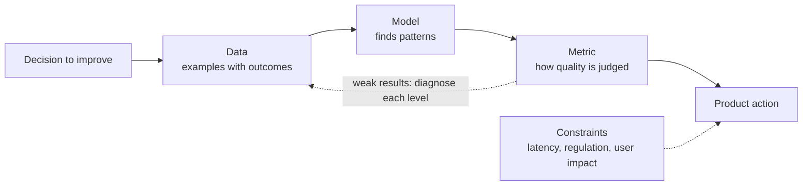
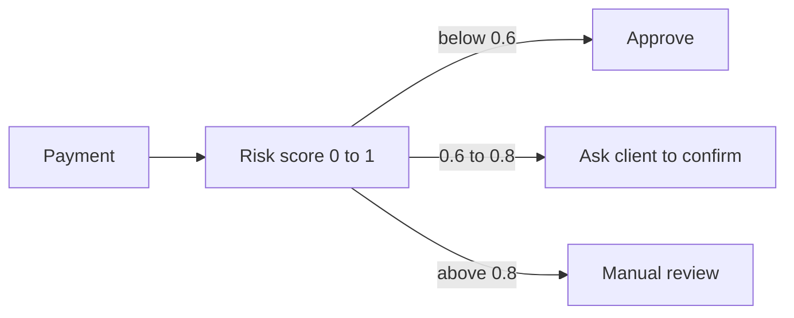
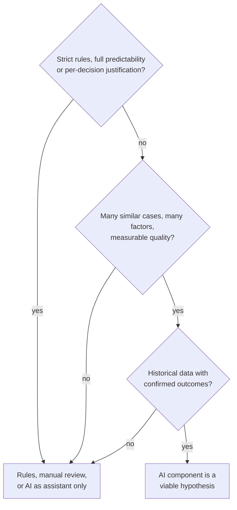

# What AI and AI Products Are

> Module: Introduction to AI Products · Topic: What Is AI and AI Products · Lesson 1
> Original: «Что такое ИИ и ИИ-продукты»

## At a glance

*Figure: An AI product described as decision, data, model, metric plus constraints.*

## Key ideas
- When someone says "let's add AI", the PM should immediately make it concrete: **what decision** will the system make, **what data** it needs, and **how quality** will be judged.
- For a PM, AI is a way to make product decisions from data — classic ML (recommend, predict ETA, classify spam, rank search, score risk, detect objects) or generative AI (chat answers, text/image generation, summaries).
- An **AI product** is one where user/business value comes from an AI component. Most of the product stays ordinary (UI, payments, auth, notifications, admin, manual review); the difference is inside how decisions are made.
- The AI component lives wherever the system **chooses, scores or predicts** — often invisible in the UI.

## Concepts & definitions
- **AI** — technologies handling tasks that need "intelligence": recognizing, forecasting, recommending, classifying, finding patterns.
- **Machine learning (ML)** — an approach within AI where a model improves at a task from data and examples. ML covers classification, recommendation, forecasting, generation, etc.
- **AI component** — the part of a product where a trained model makes a decision or produces output (not just any automated action; can be internal or an external API).
- **Threshold** — converts a model score (e.g., risk 0–1) into an action. Changing it moves the decision boundary; it does not retrain the model or change its inputs.
- **Inference** — applying a trained model to new data to get an output (score, recommendation, class, generated answer). Inference cost = cost of these calls.
- **API** — lets a product send a request to a model and receive its result (e.g., send ticket text, get category).

## Frameworks / methods
**Three components of an AI product** (diagnose problems at each level separately):

| Component | Meaning | Antifraud example |
|---|---|---|
| Data | What the model learns from / is tested on | Transaction history: amount, time, country, device, behavior, final verdict |
| Model | Finds patterns and applies them to new cases | Risk scoring trained on past legit and fraudulent payments |
| Metric | How quality is judged | Share of fraud caught, false-block rate, review time |

If results are weak, ask: missing examples in data? model fails to capture patterns? metric doesn't reflect product value? Next step could be new data, model work, or a threshold change.

**Example thresholds (antifraud):** risk < 0.6 → approve; 0.6–0.8 → ask client for extra confirmation; > 0.8 → manual review. Lower threshold = more fraud caught but more friction for honest users; higher = less friction but more missed fraud. Choosing it is a **product decision** balancing business interest, user comfort and ops load.

*Figure: The threshold turns a model score into an action; moving it trades fraud caught against friction.*

**When AI fits:**
- Many similar, repeated cases.
- Decision depends on a combination of many factors.
- Quality is measurable.
- Plus: relevant historical data with **confirmed outcomes** that covers all key scenarios (a bank with data only on approved loans, not rejected ones, trains on a biased picture).

**When AI is risky:** strict rule compliance required, full predictability needed, or the regulator needs a detailed justification per decision. Then prefer rules, manual review, or AI as an assistant only (e.g., suggesting drug dosage while the doctor decides).

*Figure: When AI fits versus when it is risky.*

**PM checklist before starting:** which decision are we improving? do we have examples with known outcomes? do data reflect real scenarios? what errors are acceptable? how will we measure quality? If answered, the AI component is a viable product hypothesis.

**Constraints to record** alongside data → model → metric: latency/SLA, regulatory rules, acceptable impact on users and business. If model errors could break them, add controls: manual review, threshold tuning, or route such cases fully to humans.

## Case / example
- Typical domains and their AI part: streaming (personal recommendations), delivery (ETA / route optimization), payments (risk scoring), email (spam filter), marketplace (search ranking).
- **Model as a product:** the same antifraud model inside a bank optimizes the fraud-caught vs extra-checks balance; sold as an API, priorities shift to latency, integration stability, cost per request and inference cost at scale. OpenAI API is a B2B example — the model is provided by an external vendor but appears as part of the client's UI.

## PM takeaways
- A "good model" is one that helps the product make sound decisions with an acceptable error level — catching fraud while blocking legit payments is a net negative.
- Models are probabilistic: in sensitive domains define the acceptable cost of error, controls, and fallback behavior upfront.
- First job: find the specific step in the process where trusting a model makes sense, then describe it as data → model → metric + constraints.
