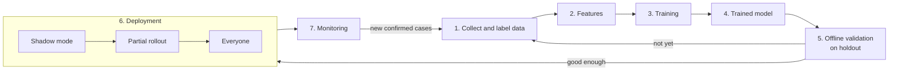
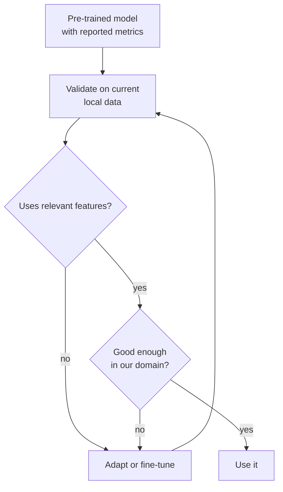

# How an ML Model Learns: Data, Training, Prediction

> Module: Introduction to AI Products · Topic: What Is AI and AI Products · Lesson 3
> Original: «Как учится ML-модель: данные, обучение, предсказание»

## Key ideas
- You don't need algorithms — you need the product flow: what data goes in, what the model learns, what it outputs, how quality is checked. This drives requirements, timelines, resourcing and the split of responsibilities between PM, analysts and ML team.
- Classic automation question: "Which rule do we write?" ML question: "From which examples will the model learn, and how will we verify it decides well enough?"
- ML task framing starts with: what object we score, what output we expect, and what data confirms the right answer.
- An error at any step of the ML chain becomes a product risk (bad prediction, unnecessary check, lost money, worse UX).

## Concepts & definitions
- **Labeling** — attaching the correct answer to each example (fraud/normal, spam/not spam, cat/dog).
- **Label** — that correct answer. Sources: human annotators (moderators), business processes (investigation outcome, confirmed refund, chargeback), or corrected past decisions.
- **Pre-trained model** — trained on external data before your task; used as a base, validated on your context, tuned if needed (e.g., vendor antifraud API, OpenAI API for an internal assistant).
- **Data quality** — fitness of data for the model's task: enough examples, reflects reality, up to date, correct labels, no strong skew/imbalance.
- **Shadow mode** — model processes live traffic but its outputs don't yet affect product decisions.
- **Holdout / test set** — part of historical data kept out of training to check the model on unseen examples.

## Frameworks / methods
**ML chain as a managed quality loop (with PM questions):**
1. **Find & collect data** — sources, cleaning, merging, labeling. *Is data available, sufficient, usable?*
2. **Input data / features** — what info the model uses (amount, device, country, time, client history, fraud true/false label). *What does the model need?*
3. **Training** — pick an algorithm; learn from labeled examples, find structure without labels, or improve from feedback. *Which learning approach fits?*
4. **Trained model** — a component for new cases. *Who owns quality and monitoring?*
5. **Offline validation** — run on held-out history, compare with known outcomes (fraud caught vs legit payments flagged). *Is quality good enough to launch?*
6. **Deployment** — shadow mode → partial rollout → everyone. *How is it integrated, and what happens on error?*
7. **Monitoring & retraining** — latency, stability, fraud caught, false blocks; add new confirmed cases. *Is it still effective; does it need retraining?*

Hidden questions: what historical examples exist; how similar are they to the future; who confirmed the right answers and how; how fast does user/fraudster behavior change?

*Figure: The ML chain as a quality loop; monitoring feeds new labeled data back into training.*

**Learning approaches:**

| Approach | Data example | Gist |
|---|---|---|
| Supervised | Bank operations labeled fraud/normal | Learns from examples with known answers |
| Unsupervised | Client behavior without predefined segments | Finds groups/structure |
| Reinforcement (RL) | Model actions + reward signal | Learns from consequences (rewards/penalties) |

Supervised is the main focus for now — it best shows the data → labels → model → metric link.

**Data problems → product effects:**

| Problem | Effect on model | Product effect | PM question |
|---|---|---|---|
| Too few examples | Sees too few situations | Unstable, esp. rare cases | Enough history, or start a manual data-collection process? |
| Outdated data | Repeats old patterns | Degrades after market/season/behavior shifts | How fast does reality change; need monitoring? |
| Non-representative | Key groups underrepresented | Worse for some users | Which segments could suffer? |
| Label errors | Learns wrong answers | Reproduces past human/process errors | How to check labels; who owns disputed cases? |
| Bias in past decisions | Inherits old skews | Automation entrenches past mistakes | What constraints before launch? |

## Case / example
- **Pre-trained model for Moscow apartment prices** (quiz): don't ship based on the authors' reported metrics (may be another city, period, market), and don't insist on training from scratch. Correct: validate on current Moscow data, check it uses relevant features (district, metro distance, building type, year, condition), adapt/fine-tune if needed. Sample size match is not the key criterion — relevance and freshness of data are.
- Holdout data exists to check performance on examples the model never saw — not to speed inference or fix labels.

*Figure: Handling a pre-trained model: validate on your own data before trusting it.*

## PM takeaways
- Label quality is a product risk: wrong labels in antifraud mean missed fraud or held legit payments.
- A pre-trained model shifts the question from "can we train it?" to "is it good enough in our domain, and what data proves it?" — banks differ in clients, geography, fraud types and rules.
- "Bad data = bad model" is concrete: know where the data's weak spots are even if you never train a model.
- Own the whole loop: data, validation, rollout mode, technical + product metrics, retraining triggers.
