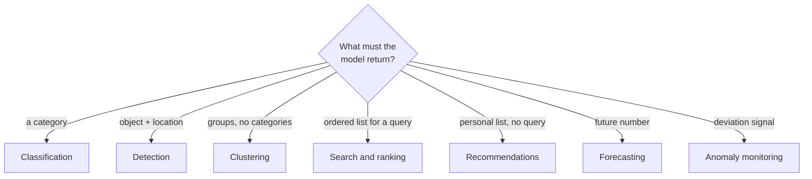
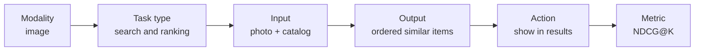
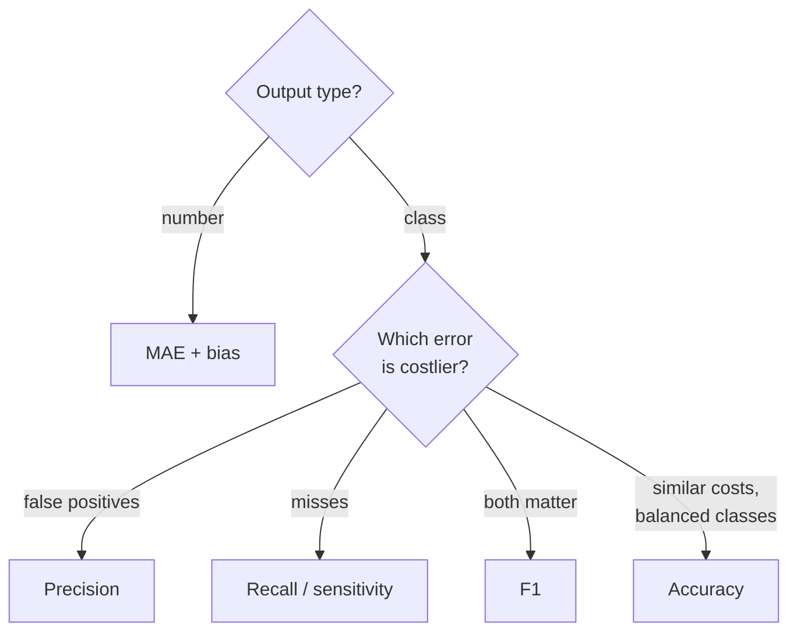

# Map of AI Product Types

> Module: Introduction to AI Products · Topic: AI Product Types by Task · Lesson 1
> Original: «Карта типов ИИ-продуктов»

## Key ideas
- "We'll use computer vision" is not a requirement. The same photo can feed classification (category), detection (scratch + location), search (similar products) or clustering — each needs different data, labeling and metrics.
- Describe any AI component by two independent characteristics: **modality** (form of data) and **task type** (what the model must return).
- One task type works across modalities (classification on text, images, audio, tables); one modality supports many tasks.

## Concepts & definitions
- **Modality** — form of input/output data: text, image, video, audio, tabular, time series; also geospatial, graph (links between users/payments/products), 3D (lidar point clouds). Text → NLP; images/video → CV. Modality drives where data comes from, storage, labeling, what the user must do (upload button, camera, voice recording) and latency/compute needs (video is heavy; voice needs recording consent).
- **Multimodality** — several formats in one scenario (photo + "similar, but black"; voice → text → meaning → voice reply).
- **Task types by output:**
  - category → **classification**
  - object + location → **detection**
  - groups of similar objects with no predefined categories → **clustering**
  - ordered list for a query → **search & ranking**
  - personal list without a new query → **recommendations**
  - future numeric value → **forecasting**
  - signal of suspicious deviation → **anomaly detection / monitoring**

*Figure: Task type is picked by the required output.*

## Frameworks / methods
**Six questions to turn an idea into AI-component requirements:** modality → task type → model input → model output → product action after the output → quality metric.
Example: photo search on a marketplace = image modality; search & ranking; input = user photo + catalog; output = ordered similar items; action = show in results; metric = NDCG@K.

*Figure: The six questions, filled in for marketplace photo search.*

**Classification**
- Input: object + features (ticket text, channel, order status; or product photo, title, price). Output: category or class probabilities.
- PM decides category set and post-prediction action. Too broad = little process value; too narrow = needs more examples, more borderline cases. If unsure between two classes → generalist agent or ask user to clarify.
- **Precision** = TP / (TP + FP) — accuracy of positive predictions. **Recall** = TP / (TP + FN) — share of real cases found. **F1** = 2·P·R / (P + R). **Macro-F1** — average of per-class F1 with equal weight (rare classes count as much as frequent ones).
- Example: 100 tickets routed to "refund", 80 correct → precision 80%; 100 real refunds, 80 found → recall 80%; F1 80%. Topics with F1 95% / 85% / 50% → macro-F1 ≈ 77%; lifting the rare one to 80% → ≈ 87%.
- **Medicine:** sensitivity (= recall: share of sick patients detected) and specificity (share of healthy correctly cleared). Example: 1,000 scans, 100 sick, 90 found → sensitivity 90%, 10 FN; 855 of 900 healthy cleared → specificity 95%, 45 FP. Lower threshold → more found, more extra exams. PM + doctors set a minimum sensitivity (e.g., ≥ 98%), then check whether the clinic can handle the resulting extra exams. Model supports, doctor decides.

**Detection**
- Answers "where?", not just "what?". Output: bounding box or mask → manual check, highlight area for a doctor, update shelf stock.
- **IoU** — overlap of predicted vs labeled area (1 = perfect, 0 = none). With a 0.5 threshold, IoU 0.6 counts; 0.3 is poor localization.
- **mAP** — mean of per-class AP; accounts for misses and false alarms. AP 80% / 70% / 50% (scratches/dents/cracks) → mAP ≈ 67%, cracks need separate work.

**Clustering**
- No ground-truth answers; model finds structure (users with similar listening, common support topics). Before running, define why you need the groups and who will interpret/name them; outputs can seed new categories, segments or scenarios.

**Search & ranking**
- Input: query + candidates + conditions (city, language, price, stock, delivery, filters). Output: ranked list.
- PM defines what "relevant" means and evaluation depth (top 5/10 matter most).
- **NDCG@K** — graded relevance (excellent/partial/weak); **MAP@K** — binary relevant/not. For "marathon shoes", NDCG@4 notices a good-match item placed below a weak one; MAP@4 only sees relevant vs not.

**Recommendations**
- Product proposes items without a new query (search = user typed "jazz for work"; recommendation = user taps "Your morning mix").
- Uses action history, content features and context (time, section, device: TV → long video, smart speaker → music/voice, car → short safe navigation).
- Key PM question: which user behavior proves the model works — track completion and fewer skips (music), add-to-cart/purchase (e-com), retention (subscriptions).

**Forecasting**
- Input: time series + context (seasonality, promos, weather, holidays, price). Output: future value or range.
- Forecast horizon must match the time the business needs to act (weekly deliveries → weekly forecast).
- **MAE** — mean absolute error in business units. Forecast 120/80/150 vs actual 100/90/130 → errors 20/10/20 → MAE ≈ 17. Also track **bias** (signed mean error): chronic underestimation → stockouts; overestimation → overstock/write-offs. MAE improvement matters only if a process uses the forecast for a decision.

**Anomaly monitoring**
- Output: alert with object and reasons. Example: fake streams in music — natural spikes come from external events, diverse users/devices/regions, varied listening; fraud shows many accounts on few devices/IPs, identical intervals, listening just past the payout threshold, abrupt start/stop, uniform behavior. Combine signals + external-event data; analysts decide disputed cases.
- Design the post-alert process: who checks, what evidence, which actions (request info, pause payouts, clear, block). False blocks hit support, artist payouts and reputation.
- **Alert precision**: 100 alerts, 25 confirmed → 25%, i.e., 75 wasted investigations.

**Picking a metric by cost of error:** precision when false positives are costly; sensitivity/recall when misses are dangerous; F1 to balance both; accuracy only with balanced classes and similar error costs; MAE for numeric forecasts.

*Figure: Choosing a metric by the cost of each error type.*

**Quick map:**

| Task | Input | Output | Metric | Business impact |
|---|---|---|---|---|
| Classification | Text, image, audio, row | Class / probabilities | Macro-F1, precision, recall | Fewer misroutes and transfers |
| Detection | Image, video | Boxes / masks | mAP, IoU | Fewer missed defects, fewer extra checks |
| Search & ranking | Text, photo, filters, candidates | Ordered list | NDCG@K, MAP@K | More successful search sessions |
| Recommendations | Tabular, text, images | Personal list | Precision@K, recall@K, NDCG@K | More purchases, fewer returns |
| Forecasting | Time series + context | Value / range | MAE, bias | Less stockout, waste, excess resources |
| Anomaly monitoring | Event stream + behavior | Alert, risk score | Alert precision | Lower losses, fewer useless investigations |

## Quiz principles
- Chair photo → similar products = CV + **search & ranking** (not classification, detection or recommendations).
- Consistency check: a component spec must align modality, task, input, output, action and metric. Common errors: calling classification "detection"; using precision for a demand forecast (use MAE/bias); listing data contents ("action history") as a modality instead of "tabular".

## PM takeaways
- First-pass questions for any ML scenario: what decision to support; what data is available before the decision; what the model returns; who gets the result; what action follows; which metric judges quality.
- Always name both the data form and the required model action when defining an AI component.
