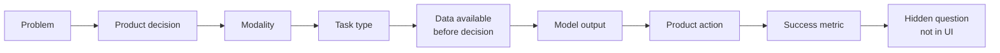

# Self-Study Assignment: Identify AI Components in Familiar Apps

> Module: Introduction to AI Products · Topic: AI Product Types by Task · Lesson 3
> Original: «Самостоятельное задание»

## Key ideas
- Goal: move from a visible user scenario to a precise AI-component definition. Output: filled templates for three apps plus a short analysis of one disagreement with an AI assistant. ~25–30 min.
- Templates: https://docs.google.com/document/d/1DdRGPd_9-RsBNaqMFFKg1CoKPhs9ptFb2ZbHprRjCWE/edit?usp=sharing

## Frameworks / methods
**Steps**
1. Pick three apps from different categories (music, bank, maps, marketplace, delivery, telemedicine). In each, choose **one specific** component — e.g., "taxi pickup-time prediction", not "AI in the taxi app" (which bundles ETA, address search, antifraud, ticket routing).
2. For each, answer: problem → product decision → modality → task type → data available **before** the decision → model output (class, area, list, number, risk score, alert) → product action → success metric → hidden question not visible in the UI.
3. Fill both templates yourself, without AI help (one = product framing; the other = model ↔ action ↔ evaluation). An honest open question beats a confident guess.
4. Ask an AI assistant the same breakdown for your three scenarios, including two options and a deciding signal for ambiguous cases.
5. Pick one meaningful mismatch (task type, inputs, action or metric) and write 4–6 sentences: where versions differ, which better ties to the product decision, what data/process knowledge is missing, whom on the team you'd ask.

*Figure: The chain to fill for each of the three chosen components.*

**Example of expected detail:** maps app ranks cafés for "café with a kids' room" → decide what to show first; text query + tabular place data; search & ranking; input = query, candidates, city, hours, distance, filters; output = ranked list; action = show results/cards; metric = NDCG@10; open question = how relevance is defined and how paid placements are handled.

**Self-check list**
- One concrete component per app.
- Decision phrased as a choice/action in the product.
- All inputs truly available before the decision.
- Output has a clear form.
- A concrete follow-up action (e.g., risk 0.82 → transaction sent to manual review), not "the system uses the result".
- Metric reflects how critical the model's errors are.
- At least one question for the team about something invisible in the UI.

## PM takeaways
- Practice decomposing a product into individual AI components; scope precision is the main skill tested.
