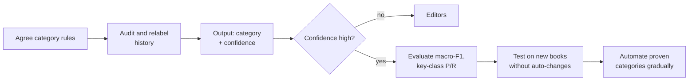
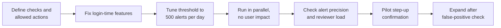
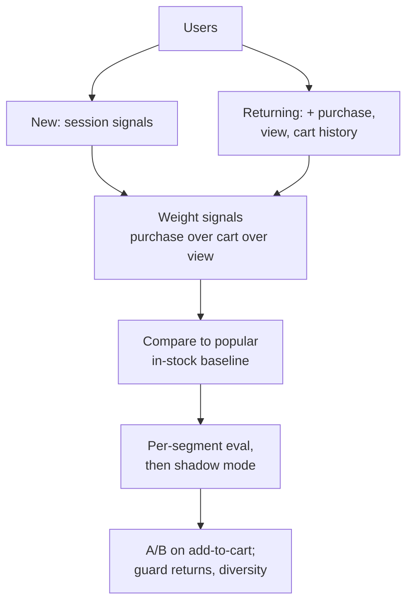

# Problem Set: AI Task Types

> Module: Introduction to AI Products · Topic: AI Product Types by Task · Lesson 4
> Original: «Задачник»

## Key ideas
- Six exercises testing: task-type identification by required output, data pitfalls (splits, labels, metadata), and designing a sensible end-to-end launch sequence.

## Concepts tested and principles behind correct answers
**Task 1 — design statements**
- A probability output doesn't make it forecasting: classifiers output class probabilities too. Task type = the decision and the meaning of the output.
- Photo upload → personally ordered similar items is still **search & ranking** (explicit query); user history is just an extra ranking signal.
- Shadow mode proves technical health (stability, latency, output distribution, diffs), **not** product impact — that needs an A/B test or limited pilot.
- Search and recs can share behavioral data; the difference is the presence of an explicit query.
- Classification and anomaly detection can take the same input (transaction stream) but return different outputs (predefined class vs deviation score).
- Forecasting needs history covering several seasonal cycles (weeks for weekly seasonality, ideally years for yearly) to separate stable patterns from one-offs.

**Task 2 — scenario → task type**
- Personal homepage picks → recommendations; hourly orders next week → forecasting; ranking candidates for a recruiter's query → search & ranking; unusual temperature+vibration → anomaly monitoring; locating car damage on a photo → detection; ticket topic → queue → classification.

**Task 3 — data pitfalls (CV)**
- Same modality ≠ same data: catalog photos (good light, flattering angles) don't work for defect detection; you need surface close-ups and real defects.
- Don't randomly split frames of one video between train and test — near-duplicates inflate offline metrics. Split by video, trip, camera or event.
- ✔ Validate medical models on another clinic / other equipment to test transfer.
- Annotator disagreement signals ambiguous labeling rules — define acceptable agreement, dispute resolution and escalation to an extra expert; don't just pick one.
- Camera metadata matters even for image-only models: the model can learn equipment quirks (e.g., one defect type only shot by one camera) instead of the defect.

**Task 4 — book catalog classification (60 sections, rare and fuzzy categories, editor fallback)** — correct sequence:
1. Agree on category purpose and rules for disputed sections → 2. audit historical labels and relabel by unified rules → 3. output = category + confidence → 4. low-confidence cases to editors → 5. evaluate macro-F1 plus precision/recall of key categories → 6. test on new-book flow without auto-changing the catalog → 7. gradually automate categories with proven quality.
- Wrong: optimize accuracy on raw history (hides rare classes, inherits contradictions); treat clusters as ready sections; merge 60 into 5 to inflate metrics while hurting catalog navigation.

*Figure: Task 4: launch sequence for book catalog classification.*

**Task 5 — account-takeover detection (analysts handle ≤ 500 alerts/day)** — correct sequence:
1. Define what security checks and allowed actions after an alert → 2. fix features available at login time → 3. tune risk score and threshold to analyst capacity → 4. run in parallel without user impact → 5. check alert precision, volume, reviewer load → 6. limited pilot of step-up confirmation for high-risk events → 7. expand after verifying false-positive rate.
- Wrong: alert on any deviation + auto-block; maximize alert count; A/B test auto-blocking before defining what counts as takeover.

*Figure: Task 5: the threshold is set by analyst capacity, not only model quality.*

**Task 6 — "You may like" recommendations (goal: more add-to-cart, without hurting diversity or return rate)** — correct sequence:
1. Separate new vs returning users → 2. new: session signals (city, categories, views, searches); returning: + purchase/view/cart history → 3. weight signals: purchase > add-to-cart > view; returns and quick bounces negative → 4. compare against a baseline of popular in-stock items by category and region → 5. evaluate per segment, then shadow mode → 6. A/B test on add-to-cart and purchases, guarding returns, availability and diversity.
- Wrong: merging segments; counting every view as positive; optimizing card opens; judging by total marketplace revenue; waiting for 10 purchases before personalizing; one metric over the whole audience.

*Figure: Task 6: recommendations rollout with segments, baseline and guardrails.*

## PM takeaways
- Design the whole post-prediction process (who acts, capacity, allowed actions) before tuning the model; thresholds depend on both model quality and human review capacity.
- Fix label rules and data splits before trusting offline metrics.
- Always compare to a simple baseline, evaluate per segment, and roll out shadow → pilot/A/B → gradual expansion.
