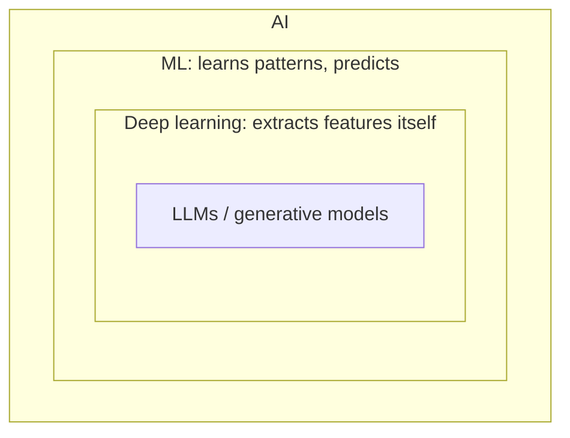
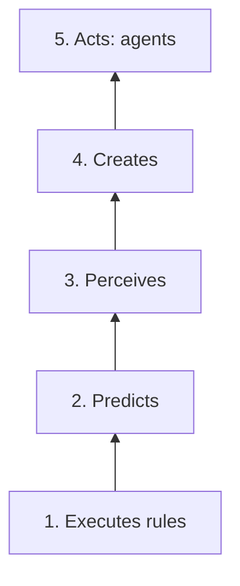
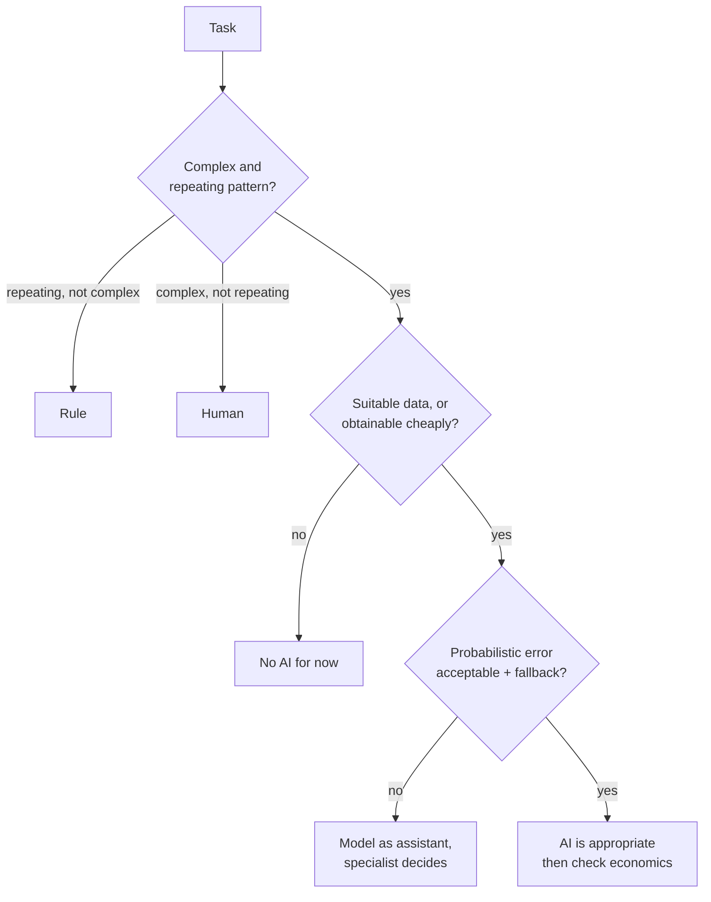

# The Role of the PM in AI Products

> Module: Introduction to AI Products · Topic: Role of the PM in AI Products · Lesson 1
> Original: «Роль PM в ИИ-продукте»

## Key ideas
- Opening case: a churn-prediction model was run like a classic IT project (requirements → roadmap → demo → launch). On real users it erred far more than in the demo; retention discounts went to loyal customers misflagged as churners; nobody had agreed an acceptable error rate. The project was quietly closed. The model was fine — the **management** wasn't ML-aware.
- AI PM is not a new profession but an **extension** of product/project management responsibilities. "PM" here covers both product (what & why) and project (on time, on budget) managers.
- Acceptance changes from "works / doesn't work" to "good enough vs a baseline on a pre-agreed metric".

## Concepts & definitions
**Four market roles (by where AI lives):**

| Role | Where AI is | Meaning |
|---|---|---|
| Classic PM | Nowhere / irrelevant | Ordinary PM |
| PM using AI | In the PM's personal tools | Drafting docs, analyzing interviews, quick prototypes; product unchanged |
| AI PM | In the product — generative models | Product creates text, images, assistant replies |
| ML PM | In the product — predictive models | Product predicts/chooses: scoring, recs, classification |

Using neural nets daily doesn't make you an AI PM (though it's becoming an industry standard skill).

**Nested technologies:** AI ⊃ ML (algorithms that learn patterns and predict) ⊃ Deep Learning (neural nets that extract complex features themselves) ⊃ LLMs / generative models (create new content). Paradox: every generative model is technically ML, yet in job postings "ML" means predictive and "AI" means generative — read the actual duties, not the title.

*Figure: Nested technologies; in job postings ML usually means predictive and AI means generative.*

**Ladder of system autonomy (bottom → top):**
1. **Executes rules** — expert-written conditions; always explainable, knows only what's encoded.
2. **Predicts** — humans prepare data and features; model finds patterns (risk, demand, segmentation).
3. **Perceives** — deep learning builds features itself; unlocks unstructured data (images, audio, text: face/speech recognition, semantic search). Needs more data/compute; team focus shifts from feature engineering to data collection and labeling.
4. **Creates** — generative models output new content (summaries, translation, images) instead of labels or numbers.
5. **Acts** — agents plan steps and call external tools (tool calling); built from lower levels, not a separate technology.

*Figure: Ladder of autonomy; use the lowest level that solves the task with acceptable quality.*

Real products mix levels (antifraud: rules + predictive model; support: predictive routing + generative replies + agent orchestration with escalation rules).

**Selection rule:** use the **lowest level** that solves the task with acceptable quality; move up only when it stops coping. Rules are transparent, fast, a great baseline — but grow costly to maintain (conflicts, sprawl, nobody deletes old ones, don't adapt to data).

## Frameworks / methods
**Four new responsibility areas:**
1. **Data as requirements** — besides scenarios and mockups: what data exists, who owns it, whether we may use it, cost to collect what's missing (e.g., clearing with legal the right to train on payment history — a new task).
2. **ML problem framing** — turn "less fraud" into: what we predict → from which data → what counts as success.
3. **Interpreting model quality with business metrics** — high model accuracy is useless if product economics don't improve; linking them is the PM's job.
4. **Experiment management** — two evaluation loops: offline eval → (optional shadow mode) → A/B test; offline success doesn't guarantee production results. Models are dynamic (data shifts, retraining, degradation), so experiments continue after release.

**Skills to build:** managing uncertainty (research may yield nothing; classic roadmaps/Scrum don't suffice — #1 skill for project managers); data literacy (requirements for completeness, quality, freshness and labeling; speak with data engineers — no need to build pipelines); ML task framing; domain vocabulary (thresholds, cost of errors, baseline); model lifecycle (monitoring, threshold calibration, fine-tuning). Job postings phrase this as "experience launching ML products", "understanding model lifecycle", "working with quality metrics", sometimes basic SQL.

**PM vs engineer boundary** — PM answers "why?" and "how good?", engineers answer "how?":
- PM: which error is costlier (blocking an honest payment vs missing fraud)? which data may we use and at what cost? when are metrics good enough to roll out to all?
- Engineer: which method achieves the balance? which features to extract? how to tune hyperparameters?
- Boundary decisions (threshold, acceptance criterion, error plan) are reached by consensus. Picking algorithms = you've crossed into engineering; an engineer alone setting the acceptable false-positive rate = they've crossed into yours. PMs don't code, train models or need the math.

**Three criteria for whether AI is justified (all must be "yes"):**
1. **Complex and repeating pattern?** Repetition without complexity → rule; complexity without repetition → human. Test: try writing the logic as a list of conditions — short list covering most cases → use rules (they become the model's baseline later); list keeps growing with exceptions → complex pattern.
2. **Suitable data available, or obtainable at reasonable cost?** Complete, fresh, legally usable, representative. Pre-trained (esp. generative) models need far less of your data — what matters is having data to **validate** on. Unsupervised tasks (anomaly detection) need data but not labels.
3. **Is probabilistic error acceptable?** Tolerable error cost + a fallback plan (human re-check, rollback to rule, interval instead of exact value) → fits. Need 100% guarantee → model only as an assistant; specialist decides.

Passing all three means AI is *appropriate*, not that it pays off — economics (data, team, maintenance) come in Module 4. Real tasks usually split: "Where's my order?" = rule + DB status; free-form product questions = model.

*Figure: The three criteria; all must be yes.*

## Case / example
- Streaming recommendations: complex repeating taste pattern, viewing history exists, a bad pick costs one click → **yes**.
- Card block after 3 wrong PINs: one rule → **no** (also transparent for client and regulator).
- Delivery ETA: dozens of factors, order history, 10-min error OK if shown as an interval → **yes**.
- 18+ content restriction: one rule, and errors are legally unacceptable → **no**.
- Dynamic pricing: complex, data exists, but reputational/legal cost of errors can be huge → **yes, with guardrails** (rule-based price floor/ceiling, model operates inside).
- Cancel booking if guest didn't confirm within 24h → **no**, a rule.

## PM takeaways
- Agree on acceptable error rates and their business cost **before** launch (the churn case failure).
- Own data rights, problem framing, metric-to-business linkage and experiment design; leave the "how" to engineers.
- Start from the simplest level (rules) and escalate only when needed.
- In this course, "AI PM" refers to a product with any model inside.
