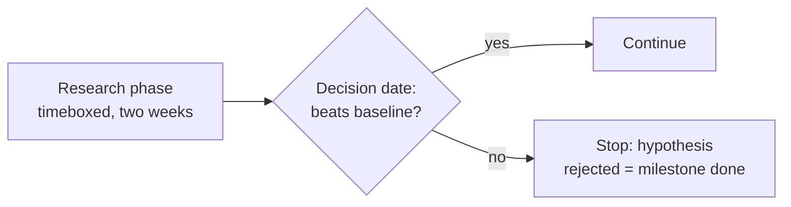
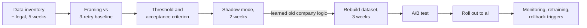

# PM Story: From Classic PM to AI PM

> Module: Introduction to AI Products · Topic: Role of the PM in AI Products · Lesson 2
> Original: «История PM: переход из классического продакта в AI-продакта»

## Key ideas
- A composite story of "Artyom", a subscription-audiobook PM with six years of classic experience who became the first PM paired with a newly formed data team — and learned AI PM through mistakes.
- Using LLMs for personal productivity ≠ AI product work: personal-tool errors you fix yourself; in-product model errors are seen by users and paid for by the company.
- A predictive model (a table of 0–1 churn probabilities) is as much an AI product as a text-generating assistant — just less flashy.

## Case / example
**Attempt 1 — churn prediction (failed)**
- Planned like a feature: 2 months, 4 sprints, demos. In week 3 the team reported three approaches, none beating a simple rule ("no login for a month"). The PM read it as a missed deadline and hunted for blame — but the team had legitimately tested hypotheses; his plan had no room for that outcome.
- **Project-management fix:** timebox the research phase with an exit criterion ("two weeks, then continue or stop"); sell stakeholders a **decision date**, not a model release date. "Hypothesis tested and rejected" is a completed milestone.
- At demo, the model beat the rule; he accepted it routinely. The missing conversation: how many real people would be wrongly flagged, what happens to them, and is that cost acceptable. Discounts went to loyal users; project shut down; trust in "AI" dropped. Churn was never even consistently defined.

*Figure: Sell stakeholders a decision date, not a model release date.*

**Attempt 2 — failed auto-renewal payments (succeeded)**
- Problem: some auto-renewals fail (no funds, bank decline, expired card); after three retries the subscription silently lapses → lost paying users. Idea: predict failures and prompt a card update in advance.
- **Step 1 — data:** "We have 3 years of payment history" from a data scientist means tables exist, not that data is complete, current and legally usable. Right move: ask for fields, period and gaps, and go to legal in parallel. (A subscription-type field had been renamed 1.5 years earlier, making older history read as empty; legal approval took **five weeks** — the longest part.) Don't buy external data before inventorying your own gaps. Labels came for free here (payment succeeded or not), unlike churn.
- **Step 2 — framing:** CFO: "lose less money on failed renewals." Good formulation: *7 days before renewal, predict probability of auto-payment failure from payment history, bank decline codes and card parameters; success = higher share of successful renewals vs the current 3-retry scheme (baseline).* Bad: "90% accuracy" (if 5 in 100 fail, always predicting "success" scores 95% and is useless); "split into reliable/risky" (a method, not a task; probabilities are more useful since thresholds can follow error cost). Expiring cards were split off to a simple rule; the model handled limits, insufficient funds, bank declines.
- **Step 3 — acceptance:** strong offline metric isn't enough. Ask what it means in people and money at different thresholds, agree acceptable false-positive share, fix acceptance criterion and an error plan, run shadow mode before A/B. Don't chase metric maximization — no stopping criterion, diminishing returns. Thresholds are a **negotiation**: team brings "at threshold X: N missed failures, M users bothered needlessly"; PM brings the business cost of each.
  - Trade-off: soft threshold → warn 40k users/month, catch most failures; strict → 9k, under half. Chose near-strict; soft in-app banner instead of email; error plan = still do three retries if ignored. Acceptance: higher renewal success with unsubscribes not above current level.
  - Two weeks of shadow mode revealed much worse live performance: history contained only the charge attempts the company chose to make, and retry rules had changed several times — the model learned the company's **own old logic**, not bank behavior. Three more weeks rebuilding the dataset, then A/B.
- **Step 4 — after A/B:** uplift → rolled out to all. When a new big project claimed the data team, the right call was to reserve capacity for data/metric monitoring, retraining and threshold review, and pre-agree **rollback triggers** to the old scheme. On-call teams see only uptime and clean logs; degrading prediction quality shows up only in quality and business metrics — often late.

*Figure: Attempt 2 (failed auto-renewals) end to end; launch is the middle of the project.*

**A year later — filtering "let's add AI" requests** (about half fail the first criterion):
- ✔ Detect insults/profanity in reviews — word lists get bypassed by typos/context; complex repeating pattern; moderation data exists; edge cases to humans.
- ✔ Next-track suggestions — taste is complex and repeating, history exists, a bad pick costs one scroll.
- ✘ Reminder after two weeks inactive — one condition; a rule (and the baseline if a model is ever needed).
- ✘ Mid-month cancellation refund amount — defined by the offer terms; must be exact and explainable; probabilistic error is legally unacceptable.
- Saying "no model needed" in time is unpraised work that saves quarters.

## Frameworks / methods
**Seven kickoff questions:**
1. Is it a complex, repeating pattern?
2. What will the model learn from and be validated on? Whose data, and may we use it?
3. What exactly do we predict, for whom, and at what moment?
4. Which error is costlier and roughly how much? Who pays for a false positive — user, support or business?
5. What's the baseline, and by how much must the model beat it to pay off?
6. What's the error plan — human re-check, rollback to rule, interval instead of exact value?
7. Who notices model drift, by which signals, and what happens next?

## PM takeaways
- New habits: plan decision dates, not release dates; ask about data before deadlines; frame as "what we predict → from what data → what success is"; accept on "how good vs baseline, at what cost"; treat launch as the middle of the project.
- Unchanged: user interviews, backlog prioritization, fighting for resources, unit economics, saying no to stakeholders. Roughly a fifth of the job changed — but it's where the costliest decisions sit.
- Don't do the data scientist's job (algorithms, hyperparameters) — arguing outside your competence wastes time and goodwill.
- Historical data is reality filtered by your past decisions; production models carry an ongoing cost that must be defended like development.
