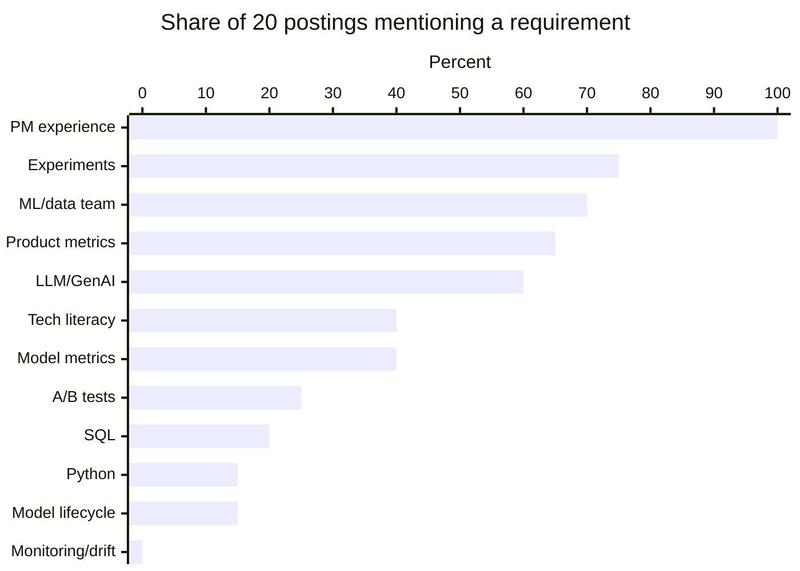

# Articles on the AI PM Role in the Market

> Module: Introduction to AI Products · Topic: Role of the PM in AI Products · Lesson 3
> Original: «Статьи о роли AI-PM на рынке»

## Key ideas
- Optional reading list in three sections (role, market, "do you even need AI"), plus the course's own snapshot of 20 job postings from H1 2026.

## Resources

**Section 1 — The AI PM role: what changes and what stays**
1. [From PRD to evals: what we found in AI PM job postings at 100+ companies](https://habr.com/ru/articles/1065410/) — Mikhail Karpov, Habr, Jul 2026 (RU, 9 min). Five new competencies layered on top of classic PM.
2. [AI Product Manager: Real Role or Buzzword?](https://productschool.com/blog/artificial-intelligence/guide-ai-product-manager) — Product School, Nov 2025 (EN, 12 min). Classic PM vs PM-using-AI vs AI PM; core insight: classic software is deterministic, AI is probabilistic.
3. [Who is an AI/ML Product Manager in 2026?](https://vc.ru/ai/2984169-kto-takoy-ai-ml-product-manager) — Mikhail Borodastov, vc.ru, Jun 2026 (RU, 4 min). Splits AI PM into "bolts external model APIs on as a feature" vs "model is the product core" — very different requirements under one title.
4. [There is no "new role" called AI Product Manager — it's hype](https://vc.ru/id876924/2172529-ai-product-manager-mif-ili-realnost) — vc.ru, Aug 2025 (RU, 3 min). Deliberate counter-argument: PM principles haven't changed.
5. [How I interview AI product managers for a large enterprise](https://habr.com/ru/articles/1038482/) — Tatiana Sezemina, Habr, May 2026 (RU, 13 min). Assessment areas, situational cases (e.g., conflict with ML team), red flags.
6. [Key competencies of a PM working with ML](https://gopractice.ru/skills/nina_romanova_2/) — Nina Romanova, GoPractice, 2022 (RU, 6 min). Data literacy for talking to data scientists, explaining model decisions in plain language, acceptance criteria.
7. [5 Principles for Product Managers Fending Off Obsolescence in the AI Era](https://a16z.com/stay-relevant-in-ai/) — a16z, May 2025 (EN, 6 min). "Interview your models": explore model behavior like user research, since its limits are unknown until tested.

**Section 2 — Market: vacancies, requirements, pay**
1. [AI/ML PM job market in Russia](https://vc.ru/ai/2956150-rynok-vakansij-dlja-ai-i-ml-product-manager-v-rossii) — Borodastov, vc.ru, May 2026 (RU, 4 min). 50 of 416 hh.ru postings sorted into six role types; salaries disclosed in only 6, typical range 400–500k RUB.
2. [Where the strongest AI/ML PM candidates come from](https://vc.ru/hr/2962753-kak-vybrat-silnogo-kandidata-na-rol-ai-ml-prodakt-menedzhera) — Borodastov, vc.ru, Jun 2026 (RU, 4 min). Which backgrounds reach an offer, from interviewing at Wildberries.
3. [T-Bank AI PM case](https://habr.com/ru/articles/971708/) — Habr, Nov 2025 (RU, 12 min). Real take-home with public solution: chatbot automates 30% of tickets vs 60% target — what to do.

**Section 3 — Do you need AI here?**
- [The first rule of ML: start without ML](https://habr.com/ru/companies/beeline/articles/587508/) (RU translation, 6 min) / [original by Eugene Yan](https://eugeneyan.com/writing/first-rule-of-ml/) (EN, 8 min). Heuristic/rule baselines first; examples where regex or a moving average beat a model.
- [No, you don't need ML. You need SQL](https://habr.com/ru/articles/417581/) — Celestine Omin translation, Habr, 2018 (RU, 5 min). E-commerce cases solved by a plain query.
- [Using AI in services](https://www.gov.uk/service-manual/technology/using-artificial-intelligence-ai-in-services) — UK Government Digital Service, updated Sep 2025 (EN, 7 min). Commitments: use AI only for a confirmed need, disclose use, ensure access to a human, be ready to switch it off.
- [Common pitfalls when building generative AI applications](https://huyenchip.com/2025/01/16/ai-engineering-pitfalls.html) — Chip Huyen, Jan 2025 (EN, 12 min). Six common mistakes; #1 is using GenAI where a simple solution suffices.
- [ML Product Manager: specifics of the job](https://gopractice.ru/skills/nina_romanova_1/) — Nina Romanova, GoPractice, 2022 (RU, 5 min). Pre-project checklist: data availability and quality, sample balance, compute cost at scale.

## Case / example — job-posting snapshot (H1 2026)
- Method: 20 full postings from 7 boards (hh.ru, getmatch, career.habr.com, T-Bank and Avito career sites, budu.jobs, dreamjob.ru); employers incl. Yandex, T-Bank, Sber, Avito, Alfa-Bank, MTS, Tochka, Ozon, etc. Classified by actual product nature, not title.
- **"AI" titles:** 6 generative, 1 mixed, 1 unclear, **0 purely predictive** → "AI" almost always means assistant/copilot/generation.
- **"ML" titles:** 2 purely generative, 3 mixed, only 1 purely predictive, 1 speech, 1 unclear → "ML" often signals the hiring department, not the technology. Examples: Tochka "ML PM" building a generative assistant (250–450k RUB net); four T-Bank "ML PM" roles all for GenAI products (image generator, copilots, assistants, GenAI search).
- **Most-requested:** PM experience 100%; hypotheses/experiments/discovery 75%; working with ML/data team 70%; product metrics 65%; LLM/GenAI understanding 60%; technical literacy 40%; model quality metrics 40%; classic research 30%; predictive tech 30%; explicit A/B 25%; SQL 20%; ML task framing 20%; Python 15%; model lifecycle 15%; data/assessors 10%; "labeling" 0%; monitoring/drift/degradation/retraining 0%.
- Conclusions: the market buys a strong classic PM unafraid of ML teams; labeling and model lifecycle aren't mentioned in postings at all; SQL/Python are asked far less than assumed. Caveat: small, SEO-biased sample skewed to large employers.

*Figure: Selected requirements from the H1 2026 posting snapshot.*

## PM takeaways
- Read job titles by actual duties (generative vs predictive), not the "AI"/"ML" label.
- Lifecycle and labeling skills are under-specified by employers — a potential differentiator.
