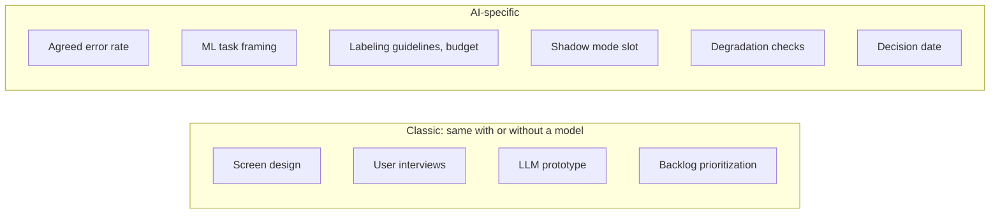
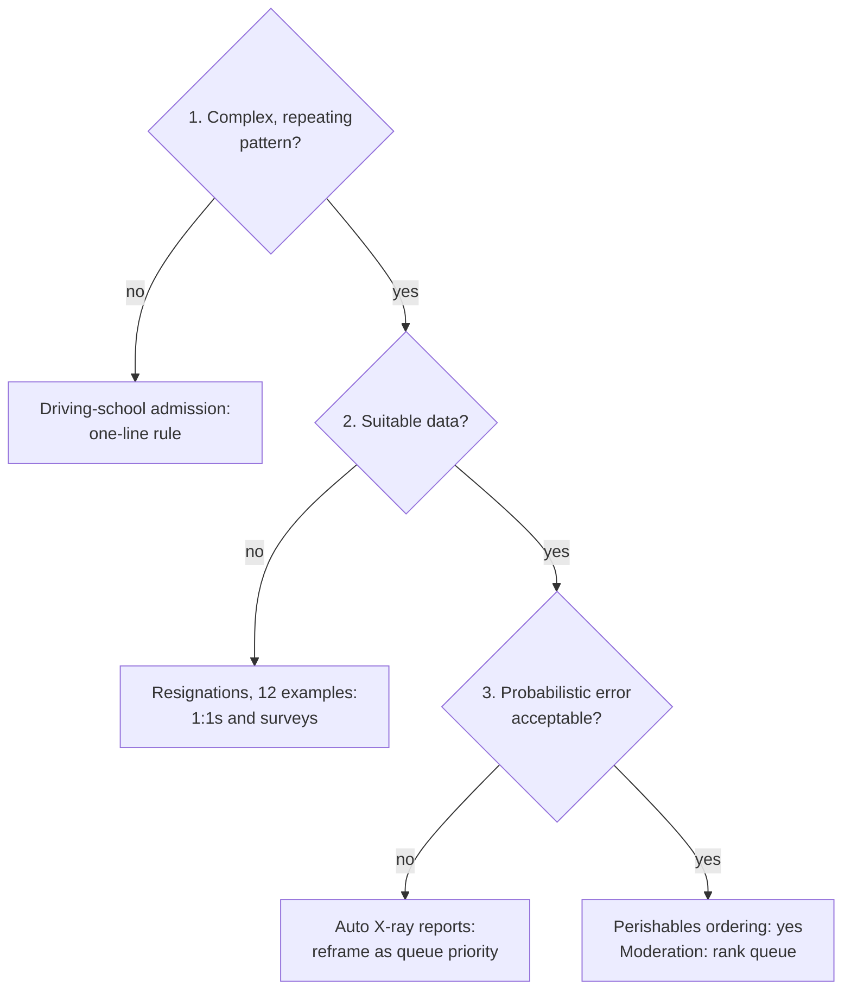

# Problem Set: AI PM Specifics and When AI Is Justified

> Module: Introduction to AI Products · Topic: Role of the PM in AI Products · Lesson 4
> Original: «Задачник. Отличаем специфику AI PM и оцениваем целесообразность ИИ»

## Key ideas
- Two exercises: (1) sort a PM's week into classic vs AI-specific tasks; (2) run five requests through the three AI-suitability criteria.
- The word "model" in a task description doesn't make the task AI-specific — look at the nature of the work.

## Concepts tested and principles behind correct answers
**Task 1 — classic vs AI-specific responsibilities**
- *Classic* (same with or without a model): designing the recommendations screen with a designer; user interviews on why the section isn't used; building a prototype with an LLM (personal productivity, not an AI product); prioritizing a quarter's backlog even if half is model work.
- *AI-specific:* agreeing with security on the acceptable share of honest transactions blocked by mistake (features don't have an "agreed error rate"; models always do — PM + business set it, not engineers alone); translating "fewer complaints about wrong charges" into "what we predict → from what data → what success is"; writing annotator guidelines and budgeting labeling of 20k tickets; scheduling two weeks of shadow mode before user tests; reserving next quarter's capacity to check forecast degradation; planning a continue/stop **decision date** instead of a release date.
- Result: 4 of 10 tasks are classic, though 3 of them looked AI-related. About a fifth of the job changes — the part with the costliest decisions.

*Figure: Task 1: sorting a PM's week by the nature of the work.*

**Task 2 — three criteria (complex & repeating pattern; suitable data; acceptable probabilistic error)**
1. **Perishable-goods ordering for 400 stores** (currently 4-week sales average; 5 years of history) → **3/3, yes.** Daily, multi-factor (weekday, weather, promos, holidays, location). Data exists without labeling, but stockouts mean recorded sales understate demand. Errors are monetary and reversible. Before starting: the current rule is the **baseline**; compute the different costs of write-off vs lost sale — this asymmetry sets which way the model may err.
2. **Driving-school exam admission** (≥ 56 hours + theory passed) → **fails criterion 1**: repeating but not complex; a one-line rule. The real problem is manual admin work; a rule is faster, cheaper and explainable to students.
3. **Predicting resignations in a 40-person startup** (12 departures in 4 years) → pattern is complex, but **fails criterion 2**: 12 examples can't train anything, and you can't buy or quickly accumulate relevant data. Alternatives: 1:1s and surveys. Ethical risk: labeling someone "about to leave" can become self-fulfilling.
4. **Auto-writing X-ray reports sent to patients without a doctor** (tens of thousands of labeled scans) → passes 1 and 2 (check representativeness across equipment), **fails 3 for this framing**: missed pathology harms health, false alarms cause stress and extra tests, and legal responsibility is the doctor's. Reframe: model flags suspicious areas and moves scans up the radiologist's queue; the doctor signs. Value = speed and prioritizing hard cases.
5. **Marketplace listing moderation** (1.5M moderated cards) → **yes, with care.** Endless ways to misrepresent across text, photos, seller history; stop-words are trivially bypassed. Labels come from the workflow — check whether moderation rules changed over time. Errors are asymmetric: a missed fake = complaint/return; wrongly removing an honest listing = direct seller loss and disputes. So the model **ranks the moderation queue**; auto-removal only at very high confidence on narrow, near-certain violations (e.g., exact duplicate of another seller's photo). Softer threshold → more violations caught, more honest sellers hit.

*Figure: Task 2: where each of the five requests lands on the three criteria.*

## PM takeaways
- A failed criterion often means "change the framing" (assistive model, queue prioritization), not "no model at all".
- Always identify the existing baseline and the cost asymmetry between error types before training.
- Sometimes the right answer to "make it smart" is a simple rule or a process fix.
- This lesson closes Module 1; Module 2 moves to designing an ML product concept (data, model type, metrics).
