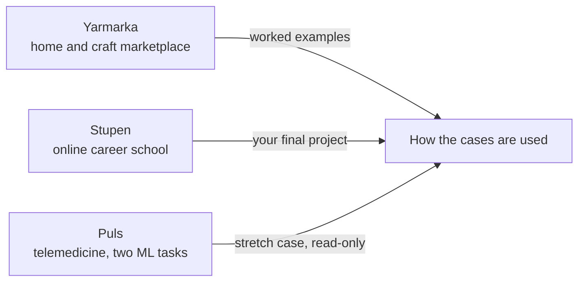
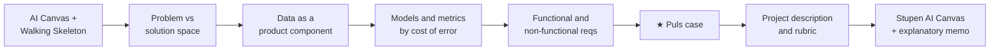

# ML Product System Design (Sprint Map)

> Module: ML Product System Design · Topic: Sprint Map · Lesson 1
> Original: «Системный дизайн ML-продукта»

## Key ideas
- Sprint goal: take a business problem stated "in the voice of the business" and design a full ML product concept — a filled-in **AI Canvas** (with justified choices of data, model type and quality metrics) plus an **explanatory memo**.
- This is the first expert-reviewed project of the course (earlier work was practice problem sets). Duration: two weeks.
- Skills targeted: AI Canvas + Walking Skeleton; framing the problem in problem space and checking three conditions for AI applicability; data requirements/risks and batch vs streaming; choosing model type and metric by the business cost of errors; functional and non-functional requirements; evaluating and formalizing the whole concept.

## Concepts & definitions
- **Three running cases** used across the course:
  - **Yarmarka** — marketplace for home, hobby and craft goods; all worked examples in this sprint.
  - **Stupen** — online career school for adults; the student's own final project (Canvas + memo) is on this case.
  - **Puls** — telemedicine service; a stretch case with two ML tasks at once, read-only, no assignment.

*Figure: the three running cases and the role each plays in the sprint.*

## Frameworks / methods
Sprint topic map (each topic fills a Canvas section):
1. Sprint map (this lesson)
2. AI Canvas — structure, difference from Lean Canvas and PRD, three Walking Skeleton blocks
3. Problem space vs solution space — avoid jumping from pain to model; three conditions where AI fits → Canvas sections 1–2
4. Data as a product component — data risks to spot before handoff; batch vs streaming basics (to ask the team good questions, not design infra)
5. Models and metrics — choose by cost of error, not by default
6. Requirements — functional/non-functional, path to the memo
7. ★ Puls case — harder conditions, compare your logic with the expert's
8. Project description — instructions, self-check list, reviewer rubric

*Figure: each sprint topic adds a layer that ends up in the final Canvas and memo.*

## PM takeaways
- Study linearly; do problem sets right after each topic.
- Keep a draft Stupen Canvas open and fill it as you go so the final assembly is consolidation, not a one-night rewrite.
- Existing PM skills (writing requirements, framing by pain not solution) still apply — the new part is how they change when a model is in the product.
- Helpers: platform search, AI assistant, mentor chat, optional data-labeling resource list in topic 4.
