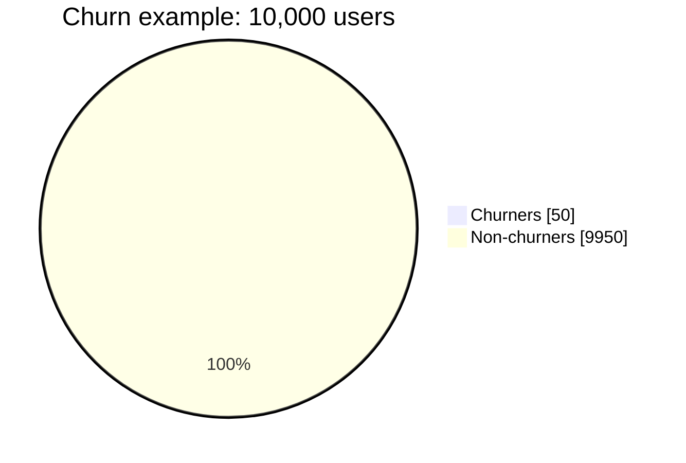
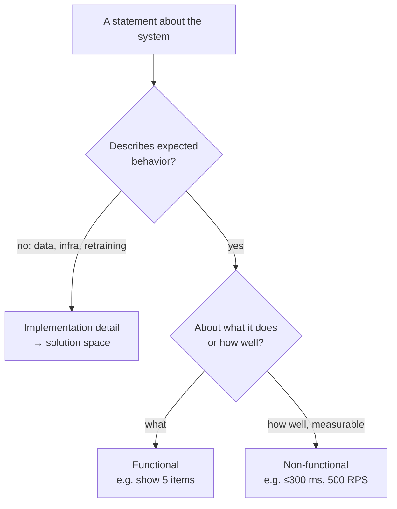

# Activation Quiz

> Module: ML Product System Design · Topic: Sprint Map · Lesson 2
> Original: «Активирующий квиз»

## Key ideas
- A warm-up quiz checking how much classic PM experience carries over to AI product system design, and previewing later topics.

## Concepts & definitions
- **Transferable PM skills** (all count): writing specs with explicit edge cases (→ Topic 6, model behavior in odd cases); stating requirements in measurable units instead of "fast"/"reliable" (→ non-functional requirements); separating the problem from the team's proposed solution (→ Topic 3); defending one success metric over another (→ Topic 5, model quality metrics).
- **Accuracy trap on rare events** — with 50 churners out of 10,000, a model that always says "won't churn" scores ~99.5% accuracy while doing nothing useful. Computable from class ratio alone, no training needed.

*Figure: a model that always says "won't churn" is right on the 9,950 and misses all 50 — ~99.5% accuracy, zero value.*

- **Data volume ≠ data fitness** — lots of data can be useless without the right labels.
- **Baseline first** — a simple rule can cover most cases; a more complex model does not automatically add business value.
- **Class imbalance is the norm**, not a niche antifraud quirk.
- **Functional vs non-functional requirements**
  - Functional = *what* the system does (show 5 recommended items on catalog open; retry 3 times on connection failure, then show error).
  - Non-functional = *how well* it does it, measurably (≤300 ms response; ≤2% false positives; 500 RPS at peak).
- **"What" vs "how"** — good requirements describe expected behavior ("flag likely fraudster before payment confirmation"; "block operation and notify user on suspected fraud"). Statements about data sources (2 years of history), infrastructure (separate servers) or retraining process are implementation, not requirements.

*Figure: sorting a statement into functional requirement, non-functional requirement or implementation.*

## PM takeaways
- Check accuracy against the class ratio before trusting it.
- Always test a rule-based baseline before committing to a model.
- Keep requirements behavior-focused; push data/infra/process choices into the solution space.
