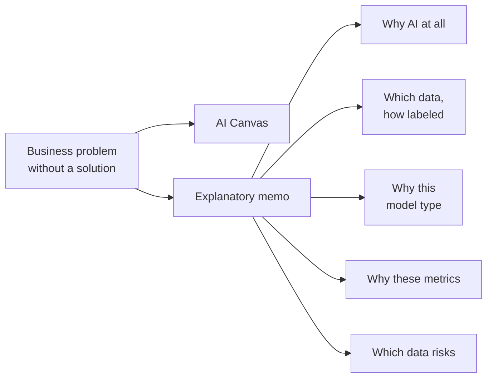
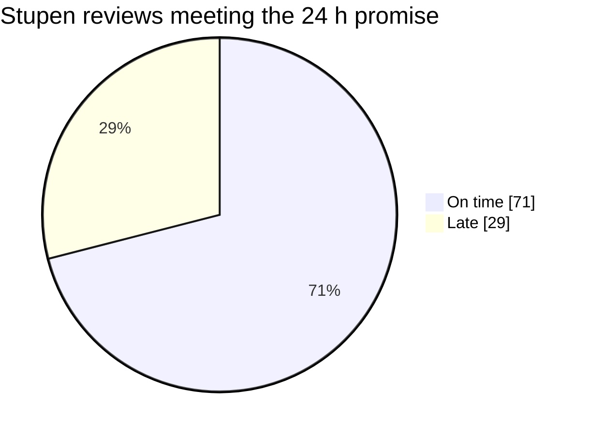

# Project Case

> Module: ML Product System Design · Topic: The Project Task · Lesson 1
> Original: «Кейс для проекта»

## Key ideas
- The whole sprint builds toward one deliverable: design an AI product concept from scratch for a real business problem given without a ready solution.
- Two artifacts: a filled-in **AI Canvas** and an **explanatory memo** justifying five decisions: why AI at all; which data and how it is labeled; why this model type; why these metrics; what data risks exist.
- First project with live expert review — treat it as a conversation with a senior colleague catching blind spots, not an exam.

*Figure: the two project deliverables and the five decisions the memo must justify.*

## Case / example
**Stupen** — online career school for adults.
- Students submit projects; reviewers check them against a checklist and write a detailed comment.
- Promised review time 24 h; actual average 26 h; on-time only in **71%** of cases.
- Evenings and weekends: queue stretches to **40+ hours**.
- Almost **half** of submissions are sent back for rework on the first attempt.

*Figure: only 71% of project reviews arrive within the promised 24 hours.*

Roles of the three cases: Stupen = your project; Yarmarka (home/craft marketplace) = worked example in nearly every topic; Puls (telemedicine) = harder stretch case near the end.

## PM takeaways
- Each topic adds one layer (tool → problem framing → data → model → metrics → requirements); by the end it forms one handoff-ready concept document.
- Start from the business pain and numbers, not from a model idea.
