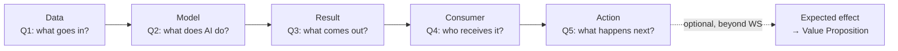
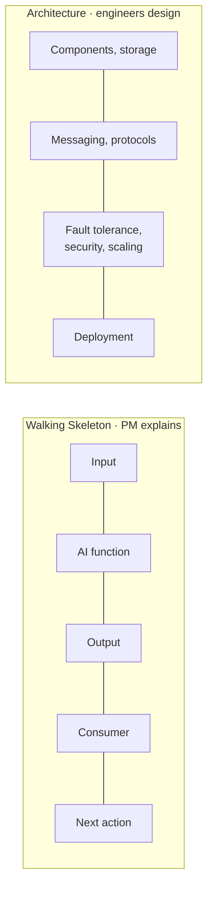
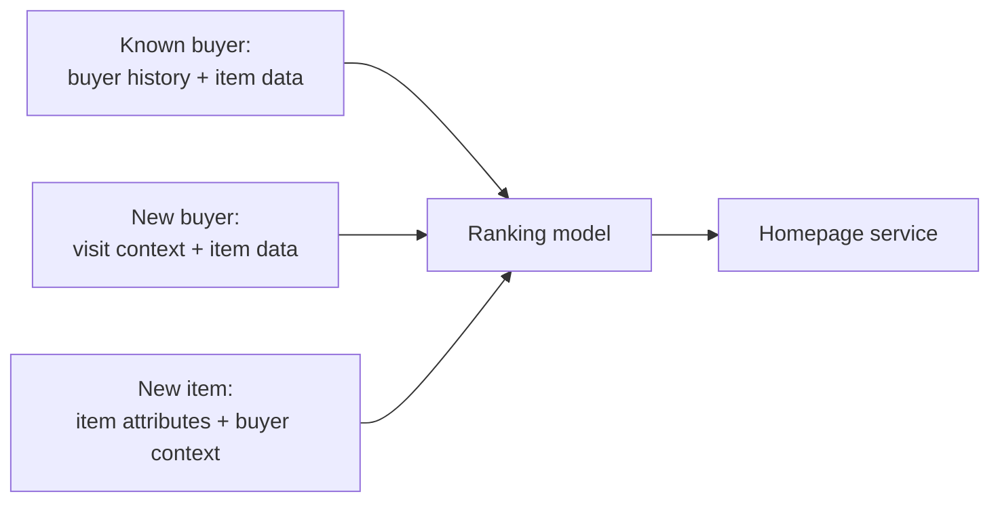

# Walking Skeleton: Checking the End-to-End Logic of an AI Product

> Module: ML Product System Design · Topic: AI Canvas Framework · Lesson 3
> Original: «Walking Skeleton: как проверить сквозную логику ИИ-продукта»

## Key ideas
- A filled Canvas lists the parts but not how the result flows through them. Walking Skeleton (WS) checks that path: input → model → who/what uses the output.
- Origin: Alistair Cockburn's software term for a minimal working end-to-end implementation through all main architectural parts (described in *97 Things Every Software Architect Should Know*, "Start with a Walking Skeleton", by Clint Shank). The course moves it earlier, to concept design, before anything is built.
- **AI creates value not when the output is computed but when it is used** in a real process or interface.
- **The product's customer and the direct consumer of the model output are often different** (Yarmarka: the homepage service consumes the list; the buyer sees the final collection).
- WS is not architecture and does not replace the Canvas — it complements it.

## Concepts & definitions
- **Minimal WS (3 mandatory elements):** data → model → result consumer.
  - **Data** — what must enter the AI component for useful work (at least one level deeper than "data": catalog, visit context, interaction history).
  - **Model** — the specific function, not "process with AI": e.g. "rank items for a collection".
  - **Consumer** — the person, interface, service or process that receives the output.
- **Extended WS:** data → model → **result** → consumer → **action**. Optionally → expected effect (beyond WS, links back to Value Proposition).
  - Result: what exactly comes out (5 ready cards? hundreds of item IDs? per-item scores sorted elsewhere?). Without it, team members imagine different products.
  - Action: what the consumer does with it; if the homepage receives the list but keeps showing the old block, the flow is incomplete.

*Figure: extended Walking Skeleton — Data, Model and Consumer are the minimal three; the five quick-check questions map onto the links.*

## Frameworks / methods
**Five-question quick check:**
1. What goes in? (basic meaning: user query, image, application data)
2. What does the AI component do? (ranks, scores risk, detects, generates an answer)
3. What does it output? (list, score, category, answer, detected objects)
4. Who/what receives it? (person, UI, another component, workflow)
5. What happens next? (decision, display, task created, review, action triggered)
A missing answer isn't a bad project — it's a question the team must clarify.

**Typical breaks:**
1. No input — "model personalizes homepage → buyer" (based on what?).
2. No result — "context + catalog → model → homepage" (receives what?).
3. No consumer — "… → ordered list" (goes where?).
4. No action — "… → list → homepage block" (shows it? filters? ignores when data is missing?).
5. Action not tied to value — chain works but just shows the same hits buyers already find; long tail still invisible.

**WS vs architecture:** WS = input, AI function, output, consumer, next action. Architecture = components, storage, messaging, protocols, fault tolerance/security/scaling, deployment. PM needs to explain the WS; engineers design the architecture.

*Figure: Walking Skeleton and architecture answer different questions and have different owners.*

## Case / example
Yarmarka scenarios:
- Known buyer, known items: buyer history + item data → ranking model → homepage service.
- New buyer: current visit context + item data → ranking → homepage (what signals replace history? what is an acceptable fallback?).
- New item: new item attributes + buyer context → ranking → homepage. Critical — if the flow works only for items with rich history, the concept contradicts its own value proposition.
- A great ranker can't help if new SKUs never enter the candidate set — fix the earlier link first.

*Figure: three Yarmarka scenarios share one skeleton but need different inputs; the new-item path is the critical one for the value proposition.*
- Alignment meeting: PM, ML, developer, homepage team and seller team each imagine a different system; writing the WS together exposes the differences.
- WS clarifies: available buyer info at serve time, new buyer/new item handling, candidate set, what the homepage receives (IDs vs ready collection), fallback/baseline when personalization fails. WS does not verify: data sufficiency, ranking quality, cost, team skills, security compliance, incremental business effect, beating the baseline, whether a non-ML solution suffices.
- Quiz principles: "behavior + item data → ranker → personal ordered list" is missing the consumer; useful extended-WS questions concern meaning of the output for the consumer, the consumer's action, entry into the current process, expected business change — not programming language or algorithm choice.

## PM takeaways
- ML adds extra risk: models depend on data and outputs vary with inputs, so check the whole usage chain early (Google's ML project guidance: build the end-to-end pipeline early, in parallel with model work; Rules of ML: simple working system first; *Hidden Technical Debt in ML Systems*: the model is a small part of the system).
- If you can't explain the simple end-to-end chain, it's too early to discuss detailed architecture.

## Further resources
- [Start with a Walking Skeleton — 97 Things Every Software Architect Should Know](https://www.oreilly.com/library/view/97-things-every/9780596800611/ch60.html) — original concept, short.
- [Growing Object-Oriented Software, Guided by Tests — Walking Skeleton chapter](https://www.oreilly.com/library/view/growing-object-oriented-software/9780321574442/ch10.html) — technical take.
- [Martin Fowler: Dependency Composition](https://martinfowler.com/articles/dependency-composition.html) — rough end-to-end integration as a WS to define boundaries.
- [Rules of Machine Learning (Google)](https://developers.google.com/machine-learning/guides/rules-of-ml) — start simple.
- [Managing ML Projects: Experiments (Google)](https://developers.google.com/machine-learning/managing-ml-projects/experiments) — build the pipeline during first experiments.
- [Hidden Technical Debt in ML Systems (Google Research)](https://research.google/pubs/hidden-technical-debt-in-machine-learning-systems/) — the model is a small part of the system.
- [Framing an ML Problem (Google)](https://developers.google.com/machine-learning/problem-framing/ml-framing) — from product goal to model objective and output.
- Books: Freeman & Pryce *Growing Object-Oriented Software, Guided by Tests*; Ameisen *Building ML Powered Applications*; Huyen *Designing ML Systems*.
