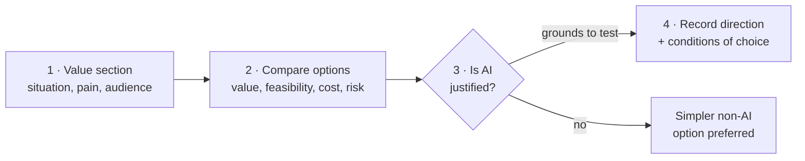
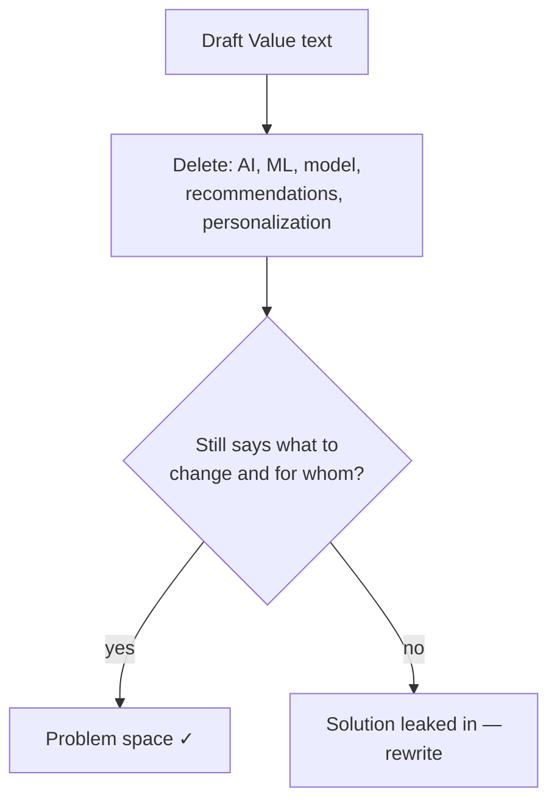

# Guide: Filling Canvas Sections 1–2 — Value and Solution Space

> Module: ML Product System Design · Topic: Problem and Solution Space · Lesson 3
> Original: «Гайд по заполнению разделов 1–2 Canvas: ценность и пространство решений»

## Key ideas
- Transfer Problem/Solution Space work into the Canvas as two short, linked entries: **Value** (what situation to change, for whom, why) and **Solution Space** (which direction is worth testing, and why this one).
- The Canvas stores the decision and its grounds, not the full research history.
- Common losses at this step: writing the business request ("we need personalization") as the problem, a conversion-growth promise as value, or "ML recommendations" straight into Solution Space.

## Frameworks / methods
**Step 1 — Value section.** Start from the signal (facts) and the three Problem Space elements (situation, measurable pain, audience); compress them into the desired change. No "implement ML recommendations" (that's a solution) and no promised conversion/GMV growth (that's an effect hypothesis).
- Hack: delete AI, ML, model, recommendations, personalization from the text. If it still says what to change and for whom, you're in problem space.
- Traps: starting with "build a recommender"; copying the business's original idea "personalize the homepage".
- Self-check (all "yes"): current situation clear? who has the problem? measurable pain shown? supporting facts? what changes if solved? describable without naming a technology?

**Step 2 — Explore Solution Space.** Compare options on the same four criteria: **value, feasibility, cost, risk.** Show the choice came from comparison, not from "add AI".
- Hack: use identical criteria for every option.
- Traps: tailoring the comparison to a favorite; treating preliminary scores as facts (mark them as hypotheses).

**Step 3 — Is AI justified?** Ask: what specific problem and measurable business result? can it be solved more simply without AI? will AI do better given quality, cost, speed, risk? Goal here is not to prove AI wins, only that it has grounds for further testing.

**Step 4 — Record the direction** including the conditions of choice (vs baseline, quality, cost, risks).

*Figure: the four steps from problem framing to a recorded solution direction.*

*Figure: the "delete the tech words" hack for checking the Value section.*

## Case / example
Yarmarka option comparison (preliminary):
| Option | Value | Feasibility | Cost | Main risk |
|---|---|---|---|---|
| Better search & filters | Medium | High | Medium | Helps mainly users with a formed query |
| Change display order | Medium | High | Low | Without user interests may not fix long-tail discoverability |
| Popularity-in-category baseline | Limited for long tail | High | Low | Concentrates traffic further on hits |
| Personalized ranking | Potentially high | Needs checking | High | Cold start, heavy data needs, may also amplify hits |

- Why AI is a candidate: catalog scale and diverse preferences limit rules; interaction history gives a potential basis — its quality and sufficiency still to verify.
- Example **Value**: help buyers find more relevant items and increase discoverability of new and niche long-tail items that currently get almost no traffic.
- Example **Solution Space**: consider personalized ranking on the homepage and collections based on user–item interaction history; compare with a popularity-in-category baseline; check whether personalization adds value given quality, cost and risks.

## PM takeaways
- Don't start from personalization and then find a problem for it: define the change → compare options → narrow to one direction worth testing.
- Choosing personalized ranking commits the next Canvas sections to proving suitable data exists, defining the model task and how to measure quality.
