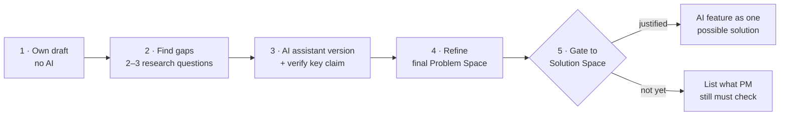

# Self-Study Assignment: Problem Space of a Real AI Feature

> Module: ML Product System Design · Topic: Problem and Solution Space · Lesson 4
> Original: «Самостоятельное задание»

## Key ideas
- Practice separating Problem Space from an existing AI solution and testing your own problem hypothesis.
- Deliverable: a short breakdown of one AI feature — initial hypothesis, verification results, refined Problem Space. ~30 minutes.
- Needs: a real product with an AI feature, any AI assistant, public sources (site, docs, team interviews, product blog).
- Pick **one specific feature**, not a whole product (e.g. taxi ETA prediction, marketplace personal picks, personalized music mix, AI call summaries) — "AI in a marketplace" is too broad.

## Frameworks / methods
1. **Draft Problem Space yourself (no AI):** what's happening now (symptom)? how does the pain show (measurable if possible)? for whom? Treat it as a hypothesis.
2. **Find gaps:** write 2–3 research questions, each closing a specific gap and answerable from data/sources (is the situation supported by data? can the scale of pain be confirmed? does the audience really have it? could another cause explain the symptom?).
3. **Check with an AI assistant:** prompt it to propose a Problem Space for the feature in the same three-part structure, fact-check each part (confirmed by public data / assumption / missing), cite open sources, and not assume the existing feature is the best solution or fit the problem to it. Then verify the single most influential claim against 1–2 sources (prefer official materials, docs, interviews, research).
4. **Refine:** compare your version, the assistant's, and your manual check; note the biggest discrepancy and which version is best supported; write the final Problem Space. "Not enough data yet" is a valid outcome.
5. **Gate to Solution Space:** treat the existing AI feature as one possible solution and answer: what specific problem and measurable business result? is there a simpler non-AI option with comparable effect? does AI win on quality, cost, speed, risk? List what a PM would still need to check; "moving to an AI solution isn't justified yet" is also a result.

*Figure: the five steps of the assignment; "not justified yet" is a valid outcome.*

**Self-check list:** one specific feature; own draft before using AI; all three elements present; no AI solution baked into the problem; compared with assistant's version; verified at least one key claim; facts separated from assumptions; missing info recorded.

## PM takeaways
- Draft first, then use AI as a sparring partner and fact-check it — don't outsource the framing.
- An existing AI feature doesn't prove AI was the best way to solve the problem.
