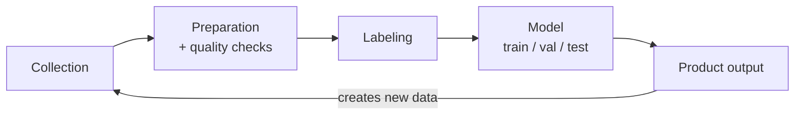
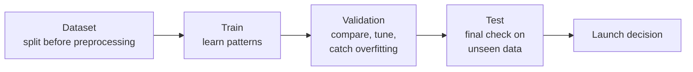
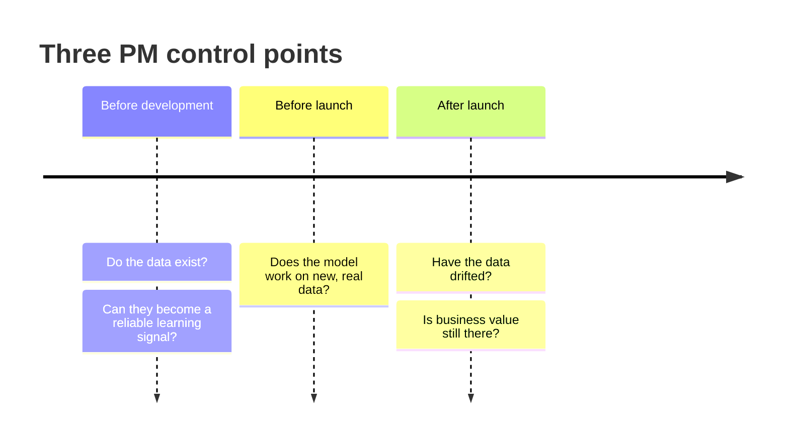

# The Data Lifecycle for ML

> Module: ML Product System Design · Topic: Data as a Product Component · Lesson 1
> Original: «Жизненный цикл данных для ML»

## Key ideas
- A popular model creates no value by itself; it becomes part of a product only when it can learn from data, receive quality signals and run in real conditions.
- **Data is part of the product, not a technical resource** — it sets the boundaries of what the AI solution can do.
- The data lifecycle is a loop: product output creates new data that goes back through collection, prep, labeling and quality checks.
- Quality starts with data, not the model.

*Figure: the ML data lifecycle is a loop — product output feeds the next round of data.*

## Concepts & definitions
- **Data quality** — how fit the data is for *this specific task*, not how much there is. Typical dimensions: accuracy, completeness, consistency, timeliness, uniqueness, validity, availability. Same dataset can be valuable for one task and useless for another. Low quality → bad decisions, skewed analytics, financial and reputational loss.
- **Learning signal types:**
  - Supervised — target known (e.g. item cards with correct category).
  - Semi-supervised — labels for only part of the data (some categories expert-checked; labeling millions of cards is too costly).
  - Unsupervised — no target (e.g. clustering buyers by behavior). Labeling needs depend on the approach.
- **Train / validation / test** — train: learn patterns/weights; validation: compare models, tune hyperparameters, detect overfitting; test: final independent check on unseen data before launch.

*Figure: the role of each data split; splitting first helps prevent leakage.*
- **Overfitting** — model memorizes training examples including noise; great on known data, poor on new. Like a student who memorized only the practice questions.
- **Data leakage** — information unavailable at prediction time leaks into training/evaluation, inflating metrics. Prevent by splitting before any preprocessing, checking feature–target relationships, excluding features unavailable in production.
- **Data drift** — input data distribution shifts over time away from training data, so quality drops even though the model hasn't changed.
- **Streaming vs batch** — choice driven by latency, data arrival frequency, requests per minute, load. Example: monthly demand forecast recomputed daily (batch) vs fraud check at payment time (near real time). Covered in detail later.

## Frameworks / methods
**Three PM control points:**
1. **Before development** — do the needed data exist and can they become a reliable learning signal? (collection → prep/quality → labeling). If not, adjust the AI solution to the constraints.
2. **Before launch** — does the model work on new, real data, not just known examples?
3. **After launch** — have the data changed; does the system still create business value? May require changing metrics, problem framing or data collection.

*Figure: where the PM checks data along the project timeline.*

**Collection questions:** do signals reflect real behavior and relate to the decision? (views may be accidental; add-to-cart signals intent; purchases most reliable but rare). Demand forecasting needs context (seasonality, promos, assortment changes); antifraud needs correct fraud examples. Also check access, legal permission to train, privacy and security limits — data can exist technically yet be unusable.

**Pre-launch checklist questions:** what data is really needed? is quality/volume sufficient? how is it collected and refreshed? what constraints does it impose? how will data changes affect quality after launch?

**PM anti-patterns:**
1. "Just improve the model" — higher CTR without more orders is no effect.
2. "Data is Data Science's job" — product decisions define the signal (what counts as interest, new items, evaluation, priority segments); otherwise DS optimizes the wrong signal.
3. "We already have data" — terabytes can be useless without the right business signal.
4. "Data is free" — collecting, storing, cleaning, labeling, protecting, refreshing cost money; sometimes more than the product's value.
5. "Data doesn't change" — a frozen model trained on items with long history degrades exactly where growth is (unique items, craftspeople).

## Case / example
- Yarmarka: 4.2M active buyers, 3.1M SKUs; data is uneven — loyal buyers have long histories, new buyers and new items have none.
- Defining the positive signal: purchases only → small training set; any click → lots of noise. Rules must match the personalization business scenario.
- Churn example: name, city, signup date, plan exist, but no usage frequency, activity change or support contacts → the key behavioral signal is missing.
- Test set must reflect the future: testing only on old popular items and long-history users looks convincing but fails for new users/items that matter to the business.
- Leakage example: a feature revealing the item is already in a placed order — great test scores, but that info doesn't exist when the recommendation is shown.
- Drift: a new item with no history today can be popular tomorrow; trends and assortment shift.
- Speed: recent views, searches, cart adds should flow with minimal delay for homepage recommendations; retraining, historical metrics and quality analysis can run in batch several times a day.

## PM takeaways
- Ask: do we really need real time, or is hourly enough? how critical is this delay at this step of the UX? how many concurrent users without degradation?
- Own the data decisions that shape the learning signal; budget the full cost of turning raw events into usable data.
