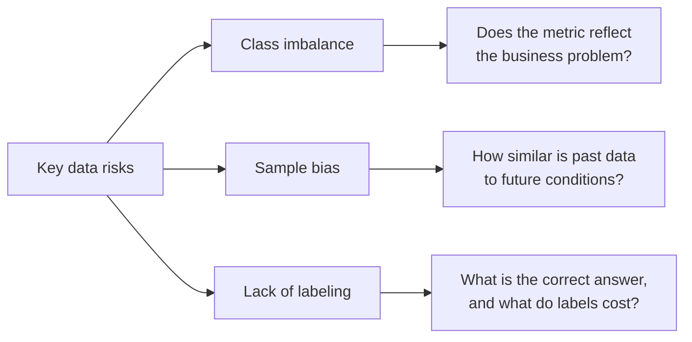
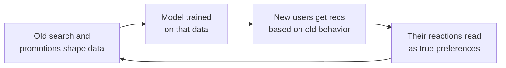

# Key Data Risks for a PM

> Module: ML Product System Design · Topic: Data as a Product Component · Lesson 2
> Original: «Ключевые риски данных для ПМ»

## Key ideas
- In classic products data mostly serves analytics; in AI products it is part of the solution. A technically good model trained on data that doesn't reflect the business problem creates no value.
- Three key data risks: **class imbalance, sample (selection) bias, lack of labeling.**
- The PM doesn't rebalance classes or build datasets (DS/ML do), but must spot the risk early, assess its product impact and decide jointly with the tech team.

*Figure: the three data risks and the PM question that exposes each one.*

## Concepts & definitions
- **Class imbalance** — rare class dominates value but not volume. A fraud model that approves everything is 99% accurate with 1% fraud yet catches nothing. High technical metrics can hide a failed business task; **different errors have different costs** (a so-so recommendation vs a missed diagnosis or undetected fraud). PM should look at the structure of errors — which cases are missed and what they cost — and decide acceptable error levels and thresholds for automated decisions. Teams use extra metrics and **rebalancing** (changing example ratios in training) so under-represented groups aren't ignored.
  - Mitigation question: does the model metric reflect the problem the business is actually trying to solve?
- **Sample bias** — training data doesn't represent the environment where the model will operate. The model only knows its training examples; one-sided examples → reproduces the past, fails in new conditions.
  - Feedback loop: data shaped by past category promotions and the old search; new users get recommendations based on old behavior, and their reactions are read as true preferences.

*Figure: the sample-bias feedback loop — the model keeps relearning the past.*
  - Credit risk model on 5 years of data: rates, digital channels, behavior and products changed → good on history, worse now.
  - Model trained mostly on experienced users drops when scaling to a new audience who phrase queries and act differently — not a math error, a too-narrow view of reality.
  - Mitigation question: how similar is past data to the conditions the model will work in?
- **Lack of labeling** — lots of records but no definition of the correct answer. Labeling = assigning the right answer per example (by humans or systems). Collecting data is relatively easy; good labels are harder and pricier. For Yarmarka relevance: purchase (rare), add-to-cart, click (may be random), long view (not always intent) — none perfect; need labeling rules and consistent judgments. Labeling cost can force a strategy change; a year of manual prep can kill an attractive idea, affecting timeline, budget and scope.

## Frameworks / methods
**Three pre-launch checks:**
1. Does the data reflect the product task (not just the logic of the previous system)? Yarmarka: do historical clicks/purchases signal real relevance or just interaction with what old search showed?
2. Can quality be evaluated honestly? Which errors are costliest; does high overall accuracy hide poor rare-case performance; does the test set resemble real use?
3. Can data quality be maintained? Plan monitoring, change detection, regular training-set refresh — launch opens the monitoring/ops phase.

**Data risk checklist:**
- Data reflects the task (real user signals tied to the business problem)?
- Data represents future users (not just part of the audience, old scenarios or prior system output)?
- Reliable learning signal (what counts as success, cost to obtain/maintain labels)?
- Metrics reflect business value (overall accuracy not hiding failure on the main problem)?
- Post-launch plan (data quality monitoring, change tracking, model refresh)?

## Case / example
- Yarmarka: interactions concentrate on a few popular items; long-tail items have far fewer views/clicks/purchases. Untreated data → model good for hits, weak for rare/new items — the opposite of the business goal (help unique items and small sellers find buyers; craftspeople are leaving).
- Historical search/purchase data was shaped by the old search system; clicks and purchases don't always mean the result was relevant.

## PM takeaways
- The Data section of the AI Canvas is a product decision, not a formality.
- Key skill: notice early that data limits the product and adjust the solution before months of development are spent.
