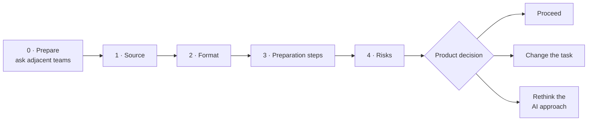
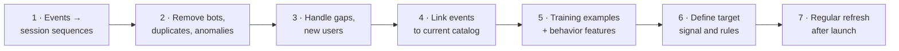

# Guide: Scaffolded Template for the AI Canvas "Data" Section

> Module: ML Product System Design · Topic: Data as a Product Component · Lesson 4
> Original: «Скаффолдированный шаблон раздела «Данные» AI Canvas. Гайд»

## Key ideas
- The Data section checks whether the product has a viable foundation before investing in development, and answers: what data does the AI need to make reliable, value-creating decisions?
- Four columns: **Source, Format, Preparation steps, Risks.** The outcome is a product decision: proceed, change the task, or rethink the AI approach.
- Volume ≠ quality: a million bad records can be worth less than ten thousand well-prepared examples.
- Structured, existing data is not automatically ready; prep time and cost must factor into the product decision.

*Figure: filling the Data section column by column ends in a product decision, not a formality.*

## Frameworks / methods
**Step 0 — Prepare.** Beyond the business problem, gather from adjacent teams: what data exists, who owns it, which related processes run now. Assess the real state of data.

**Step 1 — Source.** Describe in business terms, not system names ("Postgres/CRM/SQL" is bad). Include: what we get and why it helps, origin, owner, update frequency, access limits, stability.

**Step 2 — Format.** Structured (tables, numbers, categories) vs unstructured (text, images, audio); which fields/events/actions are available; what user signal is inside; which scenarios are represented or missing. Same info can be raw text or structured fields with ratings/categories — very different effort paths. Key question: how long will it take to extract a business signal?

**Step 3 — Preparation steps.** What must happen before use: cleaning, dedup, merging sources, unifying formats, quality checks, labeling, ongoing refresh after launch. Find out by interviewing data owners. Detail should allow estimating effort and resources. Prep isn't just cleaning — check that data reflects user intent (e.g. a purchase may come days after a search; no immediate purchase ≠ failed search).

**Step 4 — Risks.** Identify what could stop the business result: sufficiency, real-scenario fit, quality, gaps or category skew, ability to get fresh data post-launch. Write each risk as a concrete mechanism leading to product/business impact, in non-technical language; avoid generic "data may be incomplete/outdated".

**Quality check per column:**
| Column | Question it must answer |
|---|---|
| Source | Where does data come from, who manages it, can we count on access? |
| Format | What signal does it contain, does it fit the task? |
| Preparation | How much work before development? |
| Risks | What could prevent the business result? |

**Self-check:** source described via business context; signal understood; pre-use actions listed; fitness, not just volume, assessed; risks stated as product consequences; post-launch data flow verified; constraints to discuss with DS identified.

## Case / example
Generic example (support tickets): source = 24 months of CRM tickets with text, category, resolution; owner = support; daily refresh. Format = unstructured text + category, date, outcome, client ID. Prep = dedup, missing values, merge CRM and support system, unify category dictionary, build training examples. Risk = only 3% complex cases → high overall accuracy but misses what matters most.

Yarmarka Data section:
- **Source:** buyer behavior logs — impressions, views, clicks, add-to-cart, purchases with timestamps, user ID, item ID; plus item attributes and categories. Owner: marketplace analytics. Continuously collected, available for regular refresh.
- **Format:** structured events (user, item, time, interaction type, display position) + item attributes/category; history links behavior to later actions. No direct "item relevant to user" label — relevance inferred from indirect signals (clicks, views, cart, purchases).
- **Preparation:** (1) assemble events into user session sequences; (2) remove bots, duplicates, anomalies; (3) handle gaps and new users without history; (4) link events to the current catalog; (5) build training examples and behavior features; (6) define the target signal and its rules; (7) set up regular post-launch refresh; use a 12-month historical funnel log to check effect.

*Figure: Yarmarka data preparation pipeline, ending in a sustainable data process.*
- **Risks:** weak relevance signal (click ≠ interest; no click may be due to low position); cold start for new buyers and new SKUs (which are part of the business problem); sample/position bias (higher-shown items get more clicks regardless of relevance); cannibalization (collections steal search traffic without raising total conversion); popularity bias (model amplifies hits, concentrating GMV further in the short tail).

## PM takeaways
- Bad vs good: "Postgres data" vs a source that shows where the learning signal comes from and how reliably; "digital footprint, tables, big volume" vs a format that shows which actions link and what's missing; "clean, build dataset, train" vs concrete prep ending in a sustainable data process; generic risks vs mechanism-to-metric risks.
- When all columns have substantive answers, the section is ready to discuss with business and the tech team.
