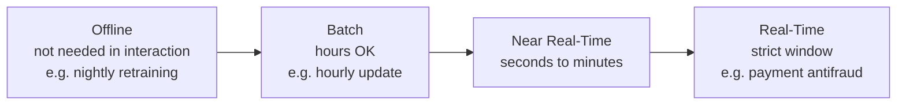
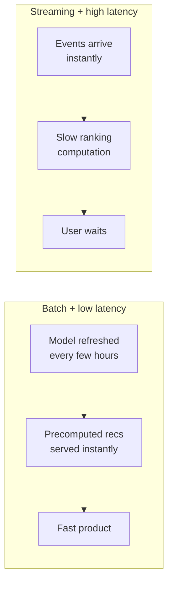
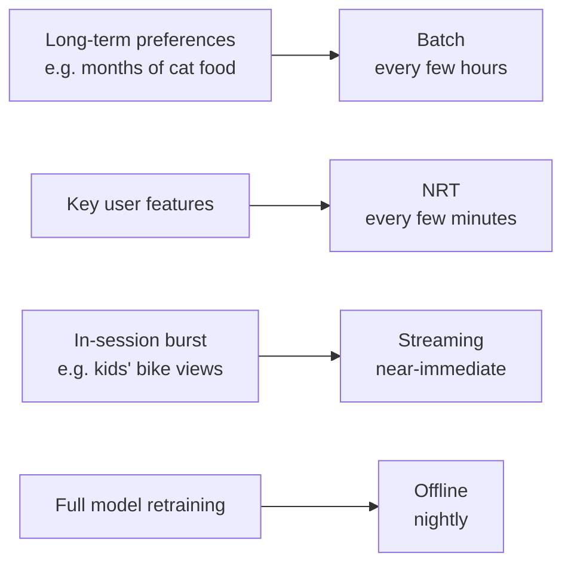

# Technical Parameters: Batch vs Streaming, Latency, RPM

> Module: ML Product System Design · Topic: Data as a Product Component · Lesson 5
> Original: «Технические параметры: batch vs streaming, latency, RPM»

## Key ideas
- Three technical question blocks: **how fresh must data be? how fast is the result needed? under what load must that speed hold?**
- PM's core question: what speed does this scenario really need, and is it worth the extra complexity and cost?
- The question isn't "how fast can we get new data" but **"what does the product lose if it gets it later?"**
- Even within one product, different signals can use different modes.
- Batch ≠ slow product; streaming ≠ fast product. Neither streaming nor minimal latency has value by itself — only via its effect on UX.
- Note: the title says RPM, but the lesson body works with **RPS** (requests per second).

## Concepts & definitions
- **Batch processing** — data accumulates and is processed in chunks on a schedule or trigger (e.g. update personalization nightly; 02:00 vs 02:01 makes no UX difference).
- **Streaming processing** — events processed as they arrive.
- **Freshness spectrum:**
  - Offline — result not needed during interaction (nightly retraining on full history).
  - Batch — needed today, a couple of hours' delay OK (hourly).
  - Near Real-Time (NRT) — should affect the product soon; seconds to minutes acceptable.
  - Real-Time — value collapses with delay; strict time window (payment antifraud — a verdict minutes later is useless).

*Figure: the freshness spectrum, from most relaxed to strictest.*
- **Streaming vs Real-Time:** streaming is *how* data is processed; real-time is a *requirement* on how fast the product reacts.
- **Latency** — time from request to result; how long the product can wait before it hurts the user or business process. Processing mode = how fast fresh data enters the system; latency = how fast the user gets a result.
  - Batch + low latency: model refreshed every few hours, precomputed recommendations served instantly — fast product.
  - Streaming + high latency: events arrive instantly but ranking computation is slow — user waits.

*Figure: processing mode and latency are independent — batch is not "slow", streaming is not "fast".*
- **RPS (requests per second)** — basic load metric; links performance to product scale.
- **RTF (Real-Time Factor)** — whether a system processes a stream faster than it arrives; used for audio/video (voice assistants, transcription, speech synthesis).
- **SLA** — measurable service requirements: parameter values, share of requests they must hold for, and load conditions (e.g. response time and availability at a given load). PM's part: define the degradation level that noticeably hurts users and business.

## Frameworks / methods
- Evaluate latency **under load**, including peaks — averages mislead; spikes during sales, when demand peaks, are what break the product.
- Questions a PM brings to architecture discussions: if actions count only after hours, do we lose in-session personalization value? how fast must results appear so delay doesn't change buyer behavior? typical homepage load and sale-time growth? what happens to latency then? how much does tightening each requirement cost? Engineers then propose infra options and trade-offs; PM decides which complexity is worth paying for.
- Two strategy options:
  1. Max everything (every action instantly, instant response, at any peak) — freshest context, highest dev/ops cost.
  2. Targeted: batch for slow-changing data, fast processing only for signals expected to matter within the session, latency set by the real scenario, capacity for expected normal and peak load. Can be product-wise just as good. Which wins must be tested.

## Case / example
- Yarmarka session: buyer browses, compares coffee machines, adds one to cart, returns to homepage. Should the feed react now (or is more coffee machines redundant after choosing)? Or update overnight? How long will they wait for search vs homepage? Can it cope with a million concurrent evening users?
- Long-term preferences (months of buying cat food) change slowly → batch every few hours; a burst of kids' bike views in one session signals situational interest → faster processing may pay off if it raises relevance now.
- Possible setup: offline nightly full retraining; NRT for some key user features every few minutes (batch can serve this); real-time via streaming for actions that should change results almost immediately.

*Figure: one Yarmarka product, different processing modes per signal — which ones truly need streaming is still to test.*
- Latency tolerance differs by moment: homepage open needs speed; a few seconds while scrolling may be fine; model updates can run in background for hours.
- Still to test: which signals need streaming vs batch, whether lower latency gives a noticeable product effect, and the point beyond which speeding up no longer changes buyer behavior.

**Quiz principles**
- Batch = periodic recompute of accumulated data; streaming = per-event processing. They differ by how/when data is processed, not volume; streaming isn't "always faster".
- "Respond within 500 ms" is a latency requirement (not RPS, data refresh rate or batch interval).
- "~200 RPS" means the system must handle about 200 requests per second overall — not a 200 ms response, not 200 data updates/sec, not a per-user cap.

## PM takeaways
- Turn technical parameters into system-design decisions tied to user experience and cost.
- Fix SLA thresholds by where degradation starts to hurt, and design for meaningful peaks.
