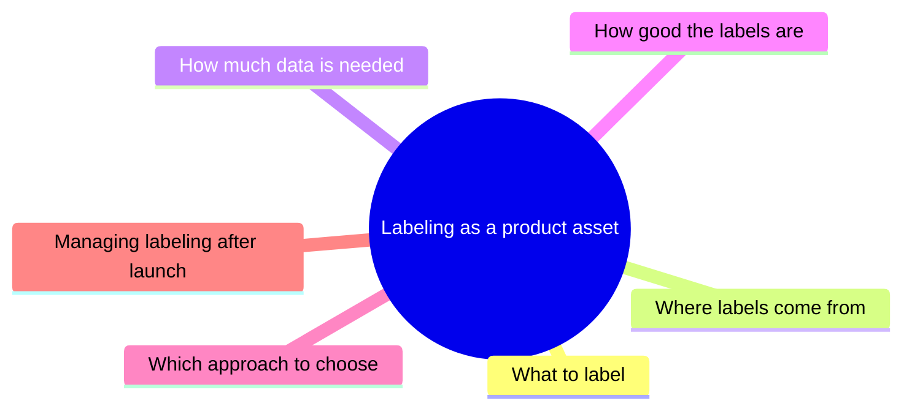

# Resource List: Articles on Data Labeling

> Module: ML Product System Design · Topic: Data as a Product Component · Lesson 6
> Original: «Ресурсный лист Статьи о data labeling»

## Key ideas
- Don't read everything: pick sources by the PM question you need answered. Resources are organized as a "PM question map" with six question areas, each at three depth levels (L1 = what is it, L2 = how to choose/do it, L3 = how to manage it as a product asset).
- Goal: treat labeling as part of the AI product — judged by quality, cost, speed and fitness of the data.

*Figure: the six PM questions that organize this list; each has L1 → L2 → L3 depth levels.*

## Resources by question

### What to label
- L1 — [Collecting Labeled Data (AWS)](https://docs.aws.amazon.com/machine-learning/latest/dg/collecting-labeled-data.html) — basics: labeled data, target, features; what supervised ML must learn to predict.
- L2 — [How to Label Data for Machine Learning (Encord)](https://encord.com/blog/how-to-label-data-for-machine-learning/) — define classes, attributes and rules before scaling labeling; test the scheme on ambiguous real examples.
- L3 — [Framing an ML problem (Google)](https://developers.google.com/machine-learning/problem-framing/ml-framing) — start from the business outcome, then model output; separates product success metrics from ML evaluation metrics; warns about proxy labels.

### Where labels come from
- L1 — [Data labeling with a human-in-the-loop (AWS SageMaker)](https://docs.aws.amazon.com/sagemaker/latest/dg/data-label.html) — human workforce options combined with automated labeling and review.
- L2 — [Data Labeling: A Complete Guide (Snorkel)](https://snorkel.ai/data-labeling) — compares strategies by task complexity, budget, scale, privacy, domain expertise.
- L3 — [United Airlines OCR active-learning pipeline (AWS blog)](https://aws.amazon.com/ru/blogs/machine-learning/how-united-airlines-built-a-cost-efficient-optical-character-recognition-active-learning-pipeline/) — production loop mixing active learning, auto and human labels to cut cost and handle drift.

### How much data is needed
- L1 — [Autoencoders for sample size estimation (npj Digital Medicine)](https://www.nature.com/articles/s41746-022-00728-0) — there's no universal label count; depends on data, model, required generalization.
- L2 — [Active learning and weak supervision (Snorkel docs)](https://docs.snorkel.ai/docs/25.4/user-guide/intro/active-learning-weak-supervision) — start small, pick the most informative examples for expert labeling, retrain, repeat.
- L3 — [Re-Active Learning: Active Learning with Relabeling (AAAI)](https://ojs.aaai.org/index.php/AAAI/article/view/10315) — sometimes relabeling existing examples beats adding new ones; compares marginal value.

### How good the labels are
- L1 — [Dataset Creation and Curation (MIT DCAI)](https://dcai.csail.mit.edu/2023/dataset-creation-curation) — human labels ≠ guaranteed ground truth; use control examples and multiple annotators.
- L2 — [Improving ML Training Data with Gold-Standard Quality Metrics (Google Research)](https://research.google/pubs/improving-ml-training-data-with-gold-standard-quality-metrics/) — measure inter-annotator agreement/consistency over several iterations.
- L3 — [RAIDP02-BP02 Set dataset quality requirements (AWS Responsible AI Lens)](https://docs.aws.amazon.com/wellarchitected/latest/responsible-ai-lens/raidp02-bp02.html) — derive measurable data-quality thresholds from release criteria.

### Which labeling approach to choose
- L1 — [Data Labeling: A Complete Guide (Snorkel)](https://snorkel.ai/data-labeling) — map of approaches: internal/external manual, semi-supervised, programmatic.
- L2 — [Essential Guide to Weak Supervision (Snorkel)](https://snorkel.ai/data-centric-ai/weak-supervision) — noisy but scalable supervision; many "pretty good" labels can beat few perfect ones.
- L3 — [United Airlines OCR pipeline](https://aws.amazon.com/ru/blogs/machine-learning/how-united-airlines-built-a-cost-efficient-optical-character-recognition-active-learning-pipeline/) — active learning reduces expensive human annotation.

### Managing labeling after launch
- L1 — [How to Write Annotation Guidelines That Work in Production (CVAT)](https://www.cvat.ai/resources/blog/how-to-create-data-annotation-guidelines) — label quality drifts as new edge cases appear; guidelines must be iterated.
- L2 — [RAIDP02-BP03 Validate quality of human and generated labels (AWS)](https://docs.aws.amazon.com/wellarchitected/latest/responsible-ai-lens/raidp02-bp03.html) — ongoing agreement tracking, control examples, bias checks, guideline updates.
- L3 — [Automate Feedback Loops Between Monitoring and Training (SE-ML)](https://se-ml.github.io/best_practices/04-data-pipeline-feedback) — link monitoring, drift detection, annotation, retraining and re-evaluation into one loop.

## PM takeaways
- Use the six questions (what / where from / how much / how good / which method / post-launch management) as a checklist when scoping any labeling effort.
- Watch for proxy labels that optimize something other than the real business outcome.
- Labeling is an ongoing process with its own quality metrics and feedback loop, not a one-off task.
