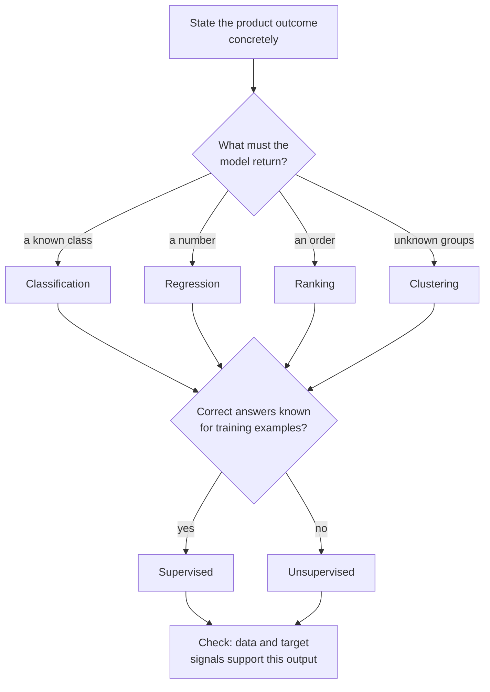
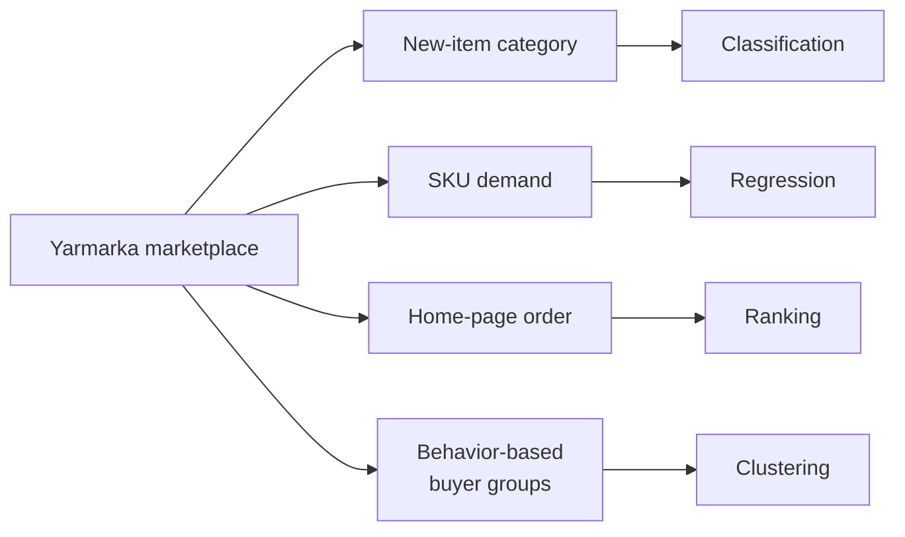

# ML Task Types for PMs

> Module: ML Product System Design · Topic: Models and Metrics · Lesson 1
> Original: «Типы ML-задач для PM»

## Key ideas
- Define the ML task by **what the product needs the model to return**, not by the algorithm name and not by the data format.
- "We need recommendations / personalization" is not a task statement — push down to the concrete system output.
- One product usually contains several models of different types.

## Concepts & definitions
| Product needs to… | Task type | Output |
|---|---|---|
| Assign a known category | Classification | Class or class probability |
| Predict a number | Regression | Number |
| Order objects | Ranking | Ordered list / score per object |
| Discover groups not defined upfront | Clustering | Groups |

- **Classification** — "which known class does this belong to?" (fraud vs normal, support ticket topic, product category). Two or more classes.
- **Regression** — numeric prediction (orders tomorrow, delivery minutes, demand). Note: "logistic regression" is actually a classification method — don't confuse method names with task types.
- **Ranking** — relative order by relevance. Distinguish "is this item suitable?" (can be classification, typically used for candidate selection from a huge catalog) from "what position should it take relative to others?" (ranking — the final step).
- **Clustering** — "what groups exist in this data?" If business already defined the segments, assigning users to them is classification, not clustering. k-means describes each cluster by a centroid (mean point of its members in feature space).
- **Supervised learning** — training examples have known correct answers (classification, regression; ranking usually trained on interaction signals).
- **Unsupervised learning** — no target; model finds structure (clustering). This split is a simplification.

## Frameworks / methods
Algorithm for choosing the task type:
1. State the product outcome concretely (e.g., "order products on the home page for this user", not "improve recommendations").
2. Write down what the model must return: class / number / order / groups.
3. Map it: class → classification, number → regression, order → ranking, unknown groups → clustering.
4. Check whether a target answer is known for training examples → supervised vs unsupervised.
5. Verify against available data: does the data actually allow producing this output, and do target signals exist?

*Figure: choosing the task type from the output, then checking labels and data.*

What to record in the AI Canvas "Model" section (no algorithm yet): input, output, task type, why.

## Case / example
"Yarmarka" marketplace home-page personalization: 3.1M products, 71% of GMV from 4% of assortment; goal includes surfacing long-tail items.
- Canvas draft: Input = buyer context + available items; Output = items ordered by predicted relevance; Type = ranking; Why = product must set relative order of many items.
- Sub-tasks in the same product: new-item category (classification), SKU demand (regression), home-page order (ranking), behavior-based buyer groups (clustering).

*Figure: one product, four models of different types.*

Quiz principles tested: output form decides the type — numbers in features (price) don't make it regression; catalog categories existing don't make ranking a classification task; an internal numeric score doesn't change a ranking goal into regression.

## PM takeaways
- Common mistake: inferring task type from data columns ("numbers → regression").
- Name the output first, then the type, then confirm data and labels support it.
- Optional reading: Google ML resources (problem framing, clustering overview, ML Crash Course); books by Chip Huyen (Designing ML Systems), Burkov (Hundred-Page ML Book), Raschka et al. (ML with PyTorch and Scikit-Learn).
