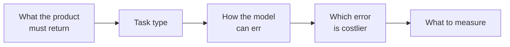
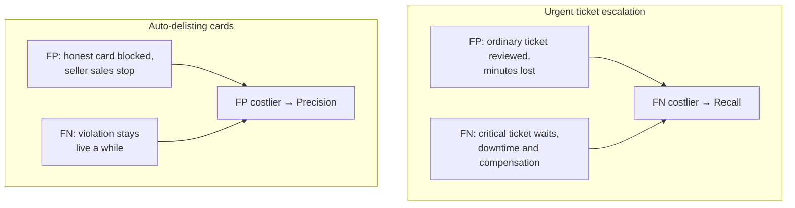
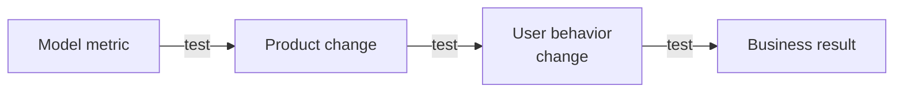

# Problem Set: Choosing the Model Type and Metric

> Module: ML Product System Design · Topic: Models and Metrics · Lesson 5
> Original: «Задачник. Выбираем тип модели и метрику»

## Key ideas
- Practice the full decision chain: **what the product must return → task type → how the model can err → which error is costlier → what to measure**.
- Four exercises: identify task type; pick a metric from error costs; fix flawed team reasoning; run the whole chain end to end.

*Figure: the decision chain practiced in every exercise.*

## Frameworks / methods
Per exercise, what's tested and the principle behind correct answers:

### 1. Task type (Yarmarka personal home page)
- Output = ordered list of items → **ranking**. Category, order count, or user groups are other tasks.
- Historical impressions/clicks/add-to-cart/purchases are known preference signals → **supervised** learning is possible.

### 2. Metric from error cost
| Situation | Positive class | FP | FN | Costlier | Primary metric |
|---|---|---|---|---|---|
| Urgent support tickets → senior specialist | Ticket truly needs escalation | Ordinary ticket sent for review (minutes lost) | Critical ticket stays in normal queue (downtime, compensation) | FN | **Recall** |
| Auto-delisting product cards for serious violations | Card truly violates rules | Honest card blocked → seller's sales stop | Violation stays live a while | FP | **Precision** |
- Positive class = the real event of interest, not "what the model flagged" (that's a prediction).
- Accuracy, F1 and ROC-AUC don't encode the business priority between errors.

*Figure: what the positive decision triggers flips which error is costlier.*

### 3. Fix the team's reasoning
- "97% accuracy, critical tickets are 2% of flow → ready to launch": wrong — an always-"normal" model gets ~98%. Check class share, FP/FN counts and their consequences; pick the metric from error cost, not by swapping metrics or adding more.
- "CTR +12% → model quality and business value grew": CTR is an intermediate product signal, not a model-quality metric (also depends on UI, block position). Verify conversion/GMV per user, compare against baseline home page, check search cannibalization. Parameter count or algorithm complexity prove nothing.
- Correct causal chain: **model metric → product change → user behavior change → business result** — each link must be tested.

*Figure: every link in the chain needs its own check; CTR sits in the middle, not at the start or end.*
- "Lower the threshold, recall rises, so product improves": lowering threshold → more positives, fewer misses, recall ↑, but FP ↑ and precision may drop. Correct framing: lower it only if the gain from fewer misses outweighs the cost of extra false alarms. Never "always lowest threshold" or "maximize recall regardless".

### 4. Full chain — flagging cards with unreliable attributes for moderators
- Model only prioritizes manual review (doesn't block); archive of 1.5M moderated cards.
- Output: probability of violation / "suspicious vs not" → **classification** (queue ordering may use the score, but the core decision is a class).
- Moderator decisions are labels → **supervised**.
- Positive = card truly has a violation. FP = honest card queued; FN = violating card not prioritized.
- Which error to control: first estimate cost of an extra review vs a missed violation — no universal "moderation metric" (not always recall/precision/F1).
- Post-launch value checks: violations actually found by moderators, number of unnecessary reviews, time-to-detection, moderation costs (not model parameter count).

## PM takeaways
- Positive class definition drives the meaning of every error — define it first.
- The same domain (moderation) can need precision or recall depending on what the positive decision triggers (auto-block vs review queue).
- Thresholds and metrics are product trade-off decisions grounded in error costs.
