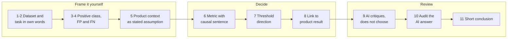
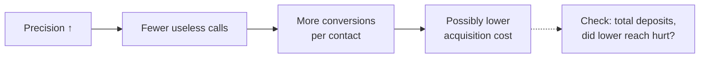
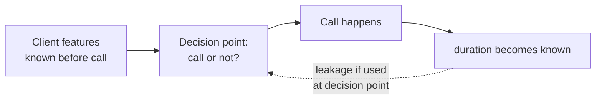

# Self-Study Assignment: Choose a Metric for an Unfamiliar Task

> Module: ML Product System Design · Topic: Models and Metrics · Lesson 6
> Original: «Самостоятельное задание. Выберите метрику для незнакомой задачи»

## Key ideas
- Real work has no prepared case or answer key: take an open binary-classification dataset, define the product context yourself, choose a metric, then use an AI assistant only as a **reviewer** of your reasoning.
- No model training or code required — the focus is framing and quality criteria.
- The metric comes from the product scenario's error costs, not from the dataset name or domain.

## Frameworks / methods
Assignment steps:
1. **Pick a dataset** (UCI ML Repository, Kaggle, other trusted source) with a binary target (convert/not, risky/normal, failure/OK, churn/stay, spam/ham). You must be able to say: what an object is, what's predicted, the two classes, what an error would cause (if not obvious, you'll define a scenario).
2. **Describe the task in your own words** (dataset, source, object, prediction, class 1, class 2) — understandable without opening the source.
3. **Fix the positive class** and why; complete "model says yes when…/no when…".
4. **Describe FP and FN** and their consequences.
5. **Set the product context** — the dataset rarely contains error costs, so state an explicit working assumption ("in this exercise X is costlier than Y because…"), separated from source facts.
6. **Choose the metric yourself** (accuracy / precision / recall / F1 / ROC-AUC) with a causal sentence: costlier error → what to control → metric → what it shows. Don't pick F1 "because it covers everything" or ROC-AUC because it looks sophisticated.
7. **Threshold direction** — which way you'd explore it and which risk to watch; no specific value without experiments.
8. **Link model metric → process/behavior change → product/business result** (a hypothesis to test later).
9. **Ask the AI assistant to critique**, not to choose: give your framing, ask whether positive class/FP/FN are right, whether the metric follows from costs, limitations, and when the context would flip the choice; forbid invented business facts.
10. **Verify the AI's answer**: same positive class, FP/FN not swapped, metric tied to cost, no accuracy-as-universal, no F1 without argument, no ROC-AUC instead of threshold analysis, no invented losses/regulations, assumptions separated from facts.
11. **Write a 3–5 sentence conclusion**: positive class, costlier error, chosen metric, causal rationale (+ note if you changed your mind after AI review).

*Figure: the assignment in three phases. Thinking comes before the AI review.*

Deliverable: one short doc with sections — dataset, framing, positive class, FP, FN, product assumption, metric, threshold, product link, AI check, conclusion. Reflection question: "What in my metric choice was decided by the product context, not the model?" — a good answer cites a concrete cost comparison.

## Case / example
Worked example (illustrative, not a template): **UCI Bank Marketing** — predict whether a client opens a term deposit (yes/no).
- Assumed use: before the next campaign, choose whom to call; call capacity is limited.
- Positive = client opens deposit. FP = called a client who doesn't convert (staff time, cost, annoyance). FN = interested client left off the list (lost deposit).
- Assumption: FP costlier because each wrong pick wastes a scarce slot → primary metric **precision**. Not recall (calls are the bottleneck), not accuracy (imbalance), not F1 (asymmetry is explicit), ROC-AUC only as a supplementary separation measure.
- Threshold: explore raising it → fewer FPs, higher precision, but recall drops; choose by campaign economics.
- Chain: precision ↑ → fewer useless calls → more conversions per contact → possibly lower acquisition cost. Verify via conversion per contact, calls per deposit, cost per deposit, total deposit volume, and whether reduced reach hurt the total.

*Figure: Bank Marketing product link, a hypothesis to verify.*
- Data check: the `duration` feature (length of the last call) is only known after the call → **leakage** if deciding before calling; drop it or move the decision point.

*Figure: a feature is usable only if it exists at decision time.*
- AI review added: FN is counterfactual in historical campaign data (we can't observe whether an uncalled client would have converted); recall would matter more if contacts were cheap, plentiful, and a missed depositor very costly.

## PM takeaways
- Data present in a table may not be available at decision time — check *when* each feature appears.
- Separate dataset facts from your product assumptions explicitly.
- Do the thinking first; use AI as a critic and audit its answer.
- Change one product condition and the right metric can flip.
