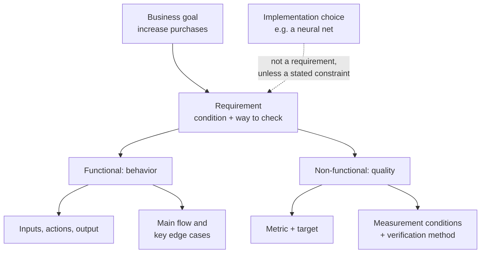
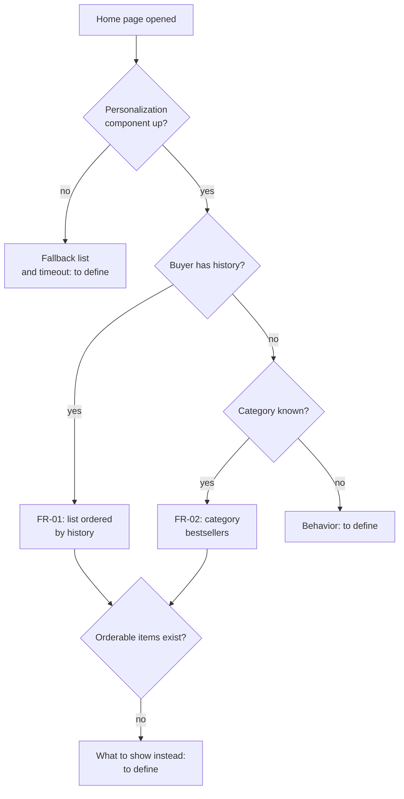
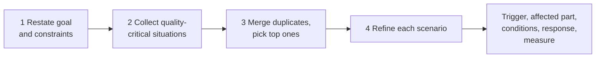

# Functional and Non-Functional Requirements for an AI Product

> Module: ML Product System Design · Topic: Requirements and Final Synthesis · Lesson 1
> Original: «Функциональные и нефункциональные требования к ИИ-продукту»

## Key ideas
- "Personalize the home page" leaves open what happens for users without history, for new items, and how long users wait — until fixed in writing, team members imagine different products.
- Requirements state expected **behavior** (FR) and measurable **quality** (NFR); they are not implementation choices.
- Model quality is a product requirement, co-owned by PM, data scientists and engineers — PM can't fully delegate "what quality is acceptable".

## Concepts & definitions
- **Requirement** — a recorded condition the product must meet, with a way to check it.
- **Functional requirement (FR)** — inputs, actions, output; must cover the main flow and key edge cases (e.g., missing data the decision usually relies on).
- Distinguish: business goal ("increase purchases") vs FR draft ("on home open, return ordered list using buyer history") vs implementation ("use a neural net"). A technology can be a legitimate *constraint* if the reason is stated.
- **Non-functional requirement (NFR)** — quality characteristics/operating conditions (latency, availability, model output quality). Needs **metric + target + measurement conditions + verification method**. "Fast/reliable/accurate" are not checkable.

*Figure: goal vs requirement vs implementation, and what FRs and NFRs must contain.*
- **Guardrail (counter) metrics** — "X grows without Y getting worse".
- **Quality Attribute Workshop (QAW)** — SEI method to elicit, prioritize and refine quality scenarios, usable before architecture exists.
- **Utility tree** — from ATAM: overall utility → quality attributes → refinements → concrete scenarios, ranked by business importance and architectural difficulty/risk.

## Frameworks / methods
FR template (simplified EARS approach by Alistair Mavin): **"When [event] under [conditions], the system shall [action and observable result]."** Split inputs/checks into separate lines if long.

FR card fields: condition, input, result, verification.

Edge cases to define explicitly (each needs its own behavior):
| Situation | Decide |
|---|---|
| Buyer has no history | How to build the list; what if even the category is unknown |
| New item with no views/purchases | When it may enter the list; what item info suffices |
| No orderable items | What to show instead |
| Personalization component down | Fallback list and timeout |
- A fallback for new buyers doesn't solve new items: bestseller-only fallback keeps zero-sales items invisible (relevant since 71% GMV comes from 4% of items) — but that doesn't mean guaranteeing every new item exposure.

*Figure: the main flow and edge cases from the lesson. Each "to define" branch needs its own requirement. New items without history are a separate question.*

Where targets come from: user task, current product measurements, system capability, cost of improvement. If no data, mark a target as preliminary and state how it'll be refined.

Who owns model-quality NFRs: PM — important scenarios, error consequences, acceptable trade-offs; data scientists — metric/data/evaluation validity; engineers — system constraints (latency, fallback).

Simplified QAW: (1) restate business goal and constraints; (2) collect quality-critical situations (late list, personalization down, new items unfindable); (3) merge duplicates, pick top ones; (4) refine each: source/trigger, affected part, conditions, expected response, measure of sufficiency.

*Figure: simplified Quality Attribute Workshop.*

Self-check (adapted from NASA requirement-quality guidance): why is it needed; is behavior/quality unambiguous; are conditions stated; can pass/fail be verified; are agreed decisions, preliminary targets and open questions distinguishable.

## Case / example
Yarmarka (all numbers are teaching assumptions, max 10 items):
- **FR-01** (buyer with history): input = view/purchase history + items deliverable to chosen city; output = 10 distinct items ordered by history, or all if fewer; verify with 15- and 6-item sets (expect 10 and 6, order preserved). Verifies composition, not usefulness of the order.
- **FR-02** (no history, category known): pass first 10 available items from that category's 30-day bestsellers list, all if fewer, preserving order; verify with a 4-item list.
- **NFR-01** latency: at steady 100 RPS, ≥95% of requests answered in ≤300 ms, measured from service receiving request to sending full response; 30-minute test with mixed buyers; no-response counts as fail. "300 ms model compute" ≠ "300 ms until on screen".
- Availability: define what counts as success and the period; state explicitly whether fallback responses count, or the system looks "available" while personalization barely works.
- **NFR-02** quality: on an agreed test set, mean share of suitable items in top 10 ≥ 0.7 **and** not below the category-bestseller baseline; ≥10 available items per scenario; same scenarios and relevance judgments for both. Also assess whether the test set includes new buyers/items — averages over buyers with history don't guarantee quality for new ones.
- Business effect checked separately: recommendation clicks may rise while search clicks fall → look at total purchases and GMV per user.

Quiz principles: complete FR = input + output + edge case without prescribing algorithm; a checkable speed NFR has share + limit under agreed conditions; if the average hits target but new items perform badly (a business goal), PM works with the team on cause, acceptable consequences and a separate criterion — neither accept nor fully delegate.

## PM takeaways
- For your project: write one FR for a significant edge case and one NFR (metric → target → conditions → verification); replace "sufficient/acceptable" with criteria.
- In the explanatory note: requirements go in section 5, metric rationale in section 8, open data questions in section 7; give each requirement an ID.
- References: EARS (Mavin), NASA "How to write a good requirement" (C.2–C.4), Google PAIR "Errors + Graceful Failure", Wiegers & Beatty "Software Requirements", Mike Cohn "User Stories Applied", SEI QAW and ATAM (sec. 5.3); ISO/IEC/IEEE 29148:2018 (requirements engineering), 15288:2023 (system life cycle), ISO/IEC 25010:2023 (product quality model incl. functional suitability), 25030:2019 (quality requirements). Standards are reference only; not needed in full now.
