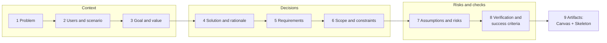
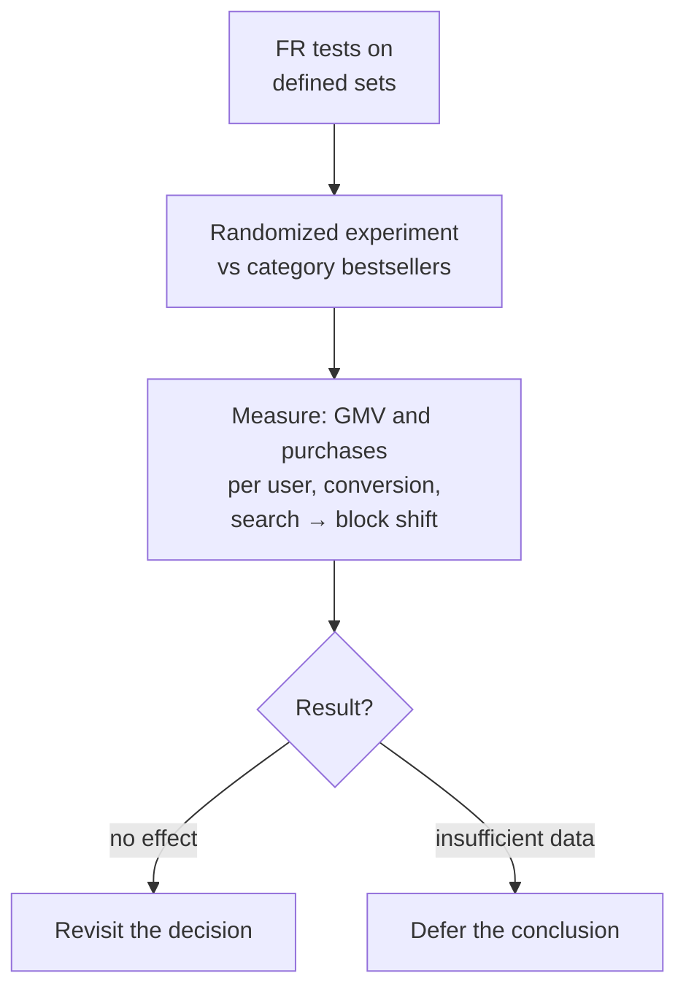

# Worked Example of an Explanatory Note

> Module: ML Product System Design · Topic: Requirements and Final Synthesis · Lesson 2
> Original: «Разобранный пример пояснительной записки»

## At a glance

*Figure: the 9-section note. Requirements in section 5 bridge decisions and verification.*

## Key ideas
- The explanatory note ties together decisions about users, data, model and value: it **justifies choices, compares alternatives and states what remains to be verified** — not just a list of decisions.
- No universal standard exists for such notes; the course uses a 9-section template you can adapt to your organization.
- Requirements are the bridge between decisions and verification.

## Case / example
Weak draft: "Use a recommender trained on purchases; main metric is CTR from the block; add new items to training to fix them; expect sales growth." Questions to ask: why only purchases if new items have none (adding rows doesn't create preference signal)? what's the baseline? why would clicks mean sales?

Yarmarka note (status: concept for pre-development discussion), condensed by section:
1. **Problem & context** — home page same for all (except city banners); 71% GMV from 4% of SKUs; rare items hard to find, makers leave. Personalization is a *solution hypothesis* — concentration doesn't prove the home page is the cause.
2. **Users & scenario** — buyers open home → system builds list → block shows it → buyer opens card. Sellers benefit, but the direct consumer of model output is the home-page component.
3. **Goal & value** — GMV per user across the whole platform (captures search cannibalization); baseline, minimum useful lift and test period set with an analyst before the experiment; GMV lift ≠ profit (account for data, dev, ops costs).
4. **Solution & rationale** — ranking (need per-buyer order; popularity is generic). Simpler alternative: category bestsellers, kept as comparison. ML justified only if gains cover extra costs. Request impressions, views, purchases, item info; impressions distinguish "shown, no reaction" from "never shown"; no purchase ≠ unsuitable. Algorithm not chosen yet.
5. **Requirements** — FR-01 (with history, 10 distinct items, all if fewer, order kept), FR-02 (no history + known category → up to 10 30-day category bestsellers), **FR-03** (item with filled category and description, orderable in buyer's city, is eligible without views/purchases — eligibility ≠ guaranteed exposure), NFR-01 (≥95% ≤300 ms at 100 RPS, 30-min test), NFR-02 (mean share of suitable items in top-10 ≥0.7 and ≥ bestseller baseline; preliminary threshold).
6. **Scope & constraints** — v1 = home-page block only, not search; confirm history availability, card completeness and data-use permissibility before training; empty-list and personalization-off scenarios need separate requirements; compute limits checked against NFR-01.
7. **Assumptions & risks** — popularity feedback loop (mitigated via item attributes + FR-03, new items evaluated separately); limited personalization for new buyers (FR-02 is a start, not proof of fit); gaps in impression logs could distort labels (check with data scientist; rethink labels if unrecoverable); residual bias from past ranking rules.
8. **Verification & success criteria** — why NFR-02: each unsuitable item takes a useful slot; limits: doesn't assess order within top-10 or prove purchase; CTR doesn't prove GMV. FR tests on defined sets; then randomized experiment vs bestsellers measuring GMV and purchases per user, overall conversion, and search→block order shift. No effect → revisit; insufficient data → defer conclusion. Output at concept stage = agreed rationale and test plan, not proven growth. (Can be written as acceptance criteria.)

*Figure: section 8 verification path for Yarmarka.*
9. **Artifacts** — attach AI Canvas and Walking Skeleton (data → ranking model → home-page service) with version/date; they must match the note.

## Frameworks / methods
Where the five justifications live: AI, data and model type → section 4; risks → section 7; metrics and trade-offs → section 8.

Three justification techniques:
1. **Keep the alternative in the comparison** — the simple baseline tests whether the model is needed at all (Google's Rules of ML).
2. **State the metric's limit of applicability** — mean share of suitable items can't distinguish two orderings of the same top-10.
3. **State each mitigation's limits** — FR-03 opens the door to selection but doesn't guarantee exposure; next question is whether items get impressions and fit buyers.

Quiz principles:
- Developer proposes moving the top-10 quality threshold into the data scientists' internal plan → keep it in the note; agree threshold and method jointly; data scientists do the technical evaluation. Measuring owner ≠ sole requirement owner; GMV target doesn't replace a quality check.
- Best strengthening of the metric rationale: note it measures top-10 composition, and ordering quality needs a separate check (not "it's widely used").
- Canvas promises support for new buyers, note covers "no history + known category", skeleton doesn't say where category comes from → agree behavior for unknown category, write requirement + test, then update Canvas and skeleton consistently (don't add a block relying on missing history, don't patch one document only, don't leave the product decision to developers).

## PM takeaways
- Add section 9 with your Canvas and Walking Skeleton (versions, dates, working links); attachments don't count toward the 500–1,000-word limit.
- For one decision, write its basis, the alternative considered, and the check that would make you revisit it.
- List open questions — what information is missing.
- Templates: [explanatory note template](https://code.s3.yandex.net/ai-product/Шаблон_пояснительной_записки.md), [Yarmarka example note](https://code.s3.yandex.net/ai-product/Пояснительная_записка_Ярмарка.md) (link labels on the page appear swapped).
- Further reading: Google ML problem framing (success criteria), Google Rules of ML (rules 1–4), Michael Nygard "Documenting Architecture Decisions", Wiegers & Beatty, Chip Huyen ch. 2.
