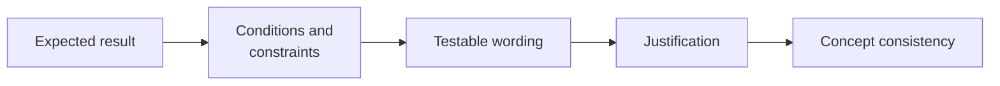
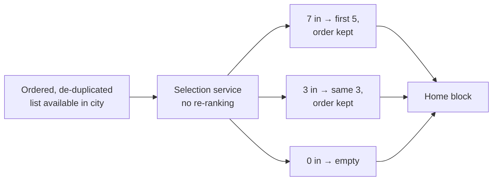
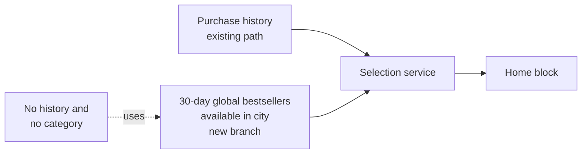

# Problem Set: From Decision to a Testable Note

> Module: ML Product System Design · Topic: Requirements and Final Synthesis · Lesson 4
> Original: «Задачник. От решения к проверяемой записке»

## Key ideas
- Four exercises (~20 min), each with two multiple-choice steps and one free-form write-up: an FR, a quality NFR, a decision justification, and fixing a cross-document contradiction.
- Overall sequence: expected result → conditions and constraints → testable wording → justification → concept consistency.
- All numbers are exercise conditions, not replacements for the lesson-2 requirements.

*Figure: the overall sequence the four exercises follow.*

## Frameworks / methods
What each exercise tests and the principle behind correct answers:

### 1. Too few items (FR)
- Service receives an already ordered, de-duplicated list of items available in buyer's city; passes ≤5 items to the home block in order; empty in → empty out; no re-ranking.
- Correct I/O is defined at the level of *this* service (ordered list in → first ≤5 out), not purchase history or full catalog.
- Complete behavior covers both edge cases (fewer than 5, empty) and preserves order; padding from the catalog or "use a recommender" are wrong (new data source / implementation, untestable).
- Model write-up: FR with tests for 7 → first 5 in order, 3 → same 3, 0 → empty. "Up to five items" alone doesn't say *which* items.

*Figure: exercise 1 FR with its three test cases, defined at the service boundary.*

### 2. "The data team will define quality" (NFR)
- Agreed: mean share of suitable items in top-5, preliminary threshold 0.8, 20 equally weighted scenarios with ≥5 available items each, relevance pre-judged.
- Measurable = metric + threshold + test set; "most lists good enough" or "use all features" are not.
- Threshold refined jointly by PM, data scientists and engineers using error consequences and a trial evaluation — not delegated to data science, nor set by PM alone without data.
- Write-up includes the calculation (per scenario: suitable/5; then average of 20) and the preliminary status + refinement path. Limitation: measures top-5 composition, not order or purchases.

### 3. Explain the choice
- Draft "chose ranking because it suits recommendations" lacks a product reason.
- Good basis: need a per-buyer order; global popularity ignores differing interests (popularity also produces an order, so don't frame them as incompatible technologies — the point is *personal* order).
- Verification plan: compare list quality with global bestsellers on agreed scenarios; test purchase impact separately; don't treat correct list length as validation or expected growth as proven.
- Write-up in 3–4 sentences: decision, basis, alternative, check + limit of the conclusion.

### 4. Make the whole concept consistent
- Canvas lists only purchase data, Skeleton passes purchase history, note promises personalization for users without history — no other preference source exists.
- The contradiction is the unsupported promise (not missing algorithm name or separate files).
- Fix: agree no-history behavior, refine FR and test, reflect in note and both diagrams (not "the algorithm will figure it out", not just attach fresh versions).
- Agreed fix in the exercise: no history and no category → first ≤5 items from a prepared list of 30-day global bestsellers available in the city, all if fewer, empty if empty, order kept. Test: 3 items → same 3 in order. Canvas: name this source, don't promise personalization here. Skeleton: add branch "global list → selection service → home block". Note: update scenario, FR, test; list updated diagram versions in section 9.
- Fixing one case doesn't prove the whole concept ready.

*Figure: the Skeleton branch added in exercise 4. Canvas, FR, test and note must all reflect it.*

## PM takeaways
- Define I/O at the boundary of the component you're specifying.
- Always spell out edge cases (short list, empty list) and order preservation.
- A metric name is not an NFR; a library of artifacts isn't consistent until their content matches the same behavior.
