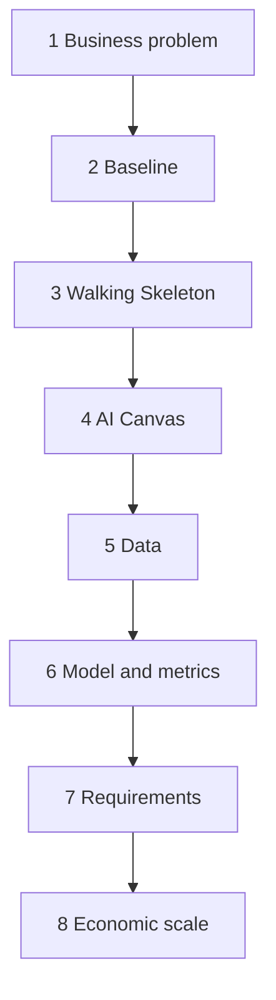
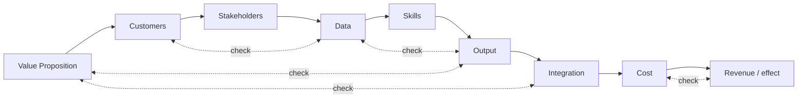

# Final Project: AI Product Concept for "Stupen"

> Module: ML Product System Design · Topic: Final Project · Lesson 1
> Original: «Проект»
> Status: assignment brief only, not yet submitted. No solution here.

## Key ideas
- First reviewed project of the program. It pulls the whole sprint together: AI Canvas, Walking Skeleton, problem vs solution space, data, model, metrics, requirements.
- What's graded is the **logic of the decisions**. Several models, features and metrics can all be acceptable.
- Don't assume ML is needed. Start from a **baseline** and show what ML must improve over it.

## Case: "Stupen" (online school of professions for adults)
- 6 tracks. Learning is built on projects checked by human reviewers (340 freelancers).
- Key numbers: 12,000 active students · 13,000 ₽/month subscription (156M ₽/month revenue) · 48,000 reviews/month at 350 ₽ each (≈10.8% of revenue) · 4.1% monthly churn.
- Pain points: SLA is 24h but the average wait is 26h, and the SLA is met only 71% of the time. Evenings and Sundays go beyond 40h. 43% of works are sent back for rework (2.4 iterations on average). "Unfair review" complaints are a top-3 support topic.
- Students who waited >36h pause their studies 9 p.p. more often. This is a **correlation, not proven causation**, so it has to be tested on live traffic.
- **Task:** design a review-queue prioritization system that gives feedback sooner to students whose risk of pausing rises with long waits.

## The 8 steps
1. **Business problem.** Who suffers, where, what measurable damage, what change you want. No solution words ("build a model").
2. **Baseline.** A transparent rule (e.g. time waited, proximity to SLA). What it covers, where it breaks, what ML should add. It's fine to conclude the baseline is enough.
3. **Walking Skeleton.** data → model → result → consumer → action, in one line.
4. **AI Canvas.** All 9 blocks (Value Proposition → Customers → Stakeholders → Data → Skills → Output → Integration → Cost → Revenue/effect). Then check the links: Data↔Output, Output↔Value, Integration↔Value, Customers↔Data, Cost↔Revenue. Record unknowns as questions; don't invent numbers.
5. **Data.**
   - Split inference-time inputs from historical training/eval data.
   - Define the target, its reference time point and the prediction horizon.
   - Check for leakage: no final wait time, review outcome or later pause in the inputs.
   - Name ≥2 data risks.
   - Treat reviewer disagreement: is the verdict a label? If you use it, how do you verify it?
   - Cold start for a new track or a new reviewer.
6. **Model and metrics.**
   - Task type matching the Output, compared with ≥1 alternative.
   - Main offline metric chosen by error cost, plus a guard metric so queue health doesn't degrade.
   - Chain: model error → queue change → student consequence → product metric.
   - Offline accuracy ≠ proof that earlier review lowers churn; that needs an experiment.
7. **Requirements.**
   - Functional: input, output, usage, edge cases, plus a fallback when data or the model is unavailable.
   - Non-functional: measurable (latency, refresh rate, availability, share of missed calculations).
8. **Economic scale.** Value of −1 p.p. monthly churn with 12,000 students at 13,000 ₽. Full ROI needs system cost, retention duration and experiment results.

*Figure: the 8 steps of the project brief. Structure only, no solution.*

*Figure: step 4, the nine Canvas blocks in order, with the five links to check as dotted lines.*

## Deliverables
- AI Canvas (template) plus Walking Skeleton.
- Explanatory note, 500–700 words, with 5 justifications:
  1. Solution vs baseline.
  2. Data and target.
  3. Model type vs an alternative.
  4. Metrics and acceptable error balance.
  5. Data risks.
- At the end of the note: requirements, fallback and the effect estimate.
- One link to a summary presentation, with edit access open, submitted in the "Review" tab.

## Self-check highlights
- Can state the problem without the words "model" or "AI".
- Output = the direct system result; product effect described separately.
- No future information in the inputs; the target is defined with its time point.
- Reviewer verdicts are not used as ground truth without validation.
- Can name the costly error and the metric that controls it.
